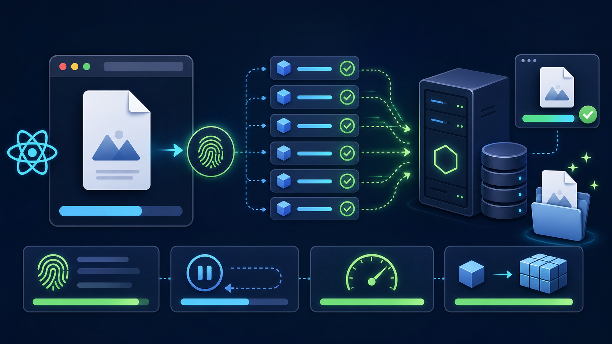
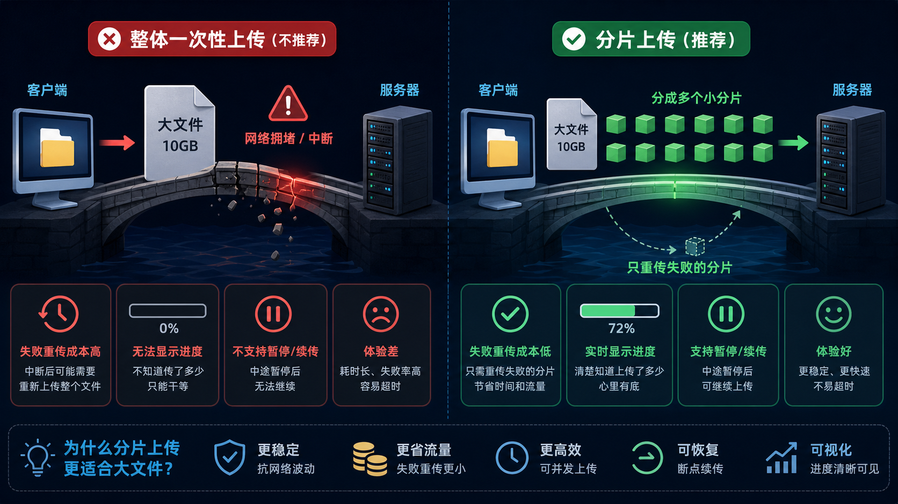
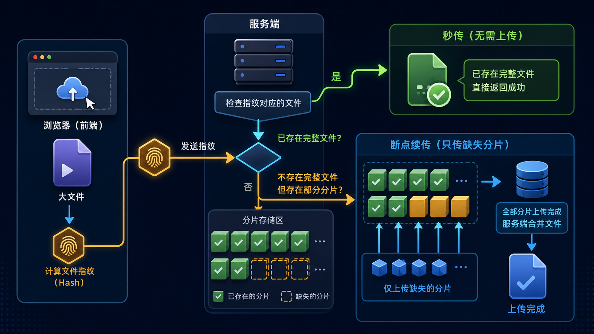
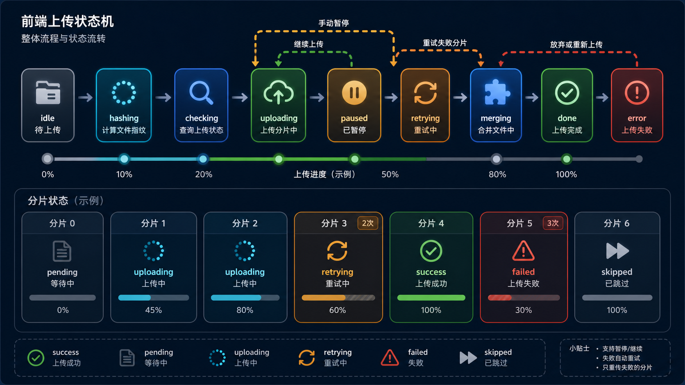
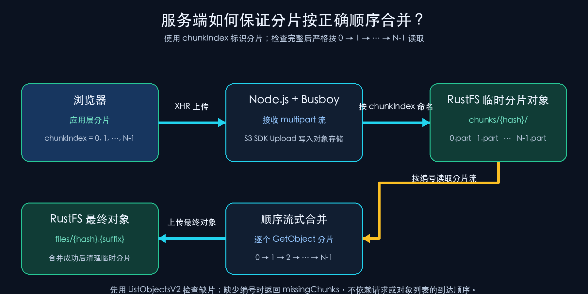

# 从 0 到 1 实现大文件上传：分片、秒传、断点续传、暂停、重试与服务端合并



这篇文章会用一个完整的前后端项目，带你理解“大文件上传”是怎么实现的。项目使用 React + Vite 做前端，Node.js 原生 HTTP 模块做后端，RustFS 作为 S3 兼容对象存储。

前端负责选择文件、切片、计算 hash、上传分片、显示进度、暂停继续和失败重试；后端负责查询上传状态、把分片写入 RustFS、按顺序流式合并对象并返回文件列表。上传文件和分片不保存在 Node 服务的本地目录中。

如果你是初学者，不用担心这套东西看起来名词很多。我们会从最朴素的问题开始讲：为什么普通上传不适合大文件？为什么要切片？为什么要 hash？为什么能断点续传？后端为什么不能直接把所有数据读到内存里？一步一步拆开之后，你会发现大文件上传并不是魔法，而是一组很朴素的工程动作。

## 目录

1. 为什么普通上传不适合大文件
2. 大文件上传的核心思路
3. 本项目实现了哪些能力
4. 整体流程图
5. 前端第一步：选择文件并切片
6. 前端第二步：用 Web Worker 计算文件 hash
7. 前端第三步：查询服务端状态，实现秒传和断点续传
8. 前端第四步：用 XHR 上传分片并显示实时进度
9. 前端第五步：并发上传、暂停、继续和失败重试
10. 后端第一步：接口设计
11. 后端第二步：用 Busboy 流式接收分片
12. 后端第三步：按 hash 存储分片和最终文件
13. 后端第四步：合并分片，并保证合并过程可靠
14. 页面状态和分片状态怎么设计
15. 完整上传流程走一遍
16. 初学者常见问题
17. 这套方案还能怎么优化
18. 总结

## 1. 为什么普通上传不适合大文件

我们先想一个最简单的上传方式。用户选择一个文件，前端把整个文件塞进 `FormData`，然后发给后端：

```ts
const formData = new FormData();
formData.append('file', file);
await fetch('/upload', {
  method: 'POST',
  body: formData,
});
```

如果文件只有几十 KB、几 MB，这样做当然没问题。很多头像上传、图片上传、普通表单附件上传都是这么做的。

但是当文件变成 500 MB、1 GB、5 GB 时，问题就开始出现了。

第一个问题是上传时间太长。网络稍微慢一点，一个大文件可能要传几分钟，甚至几十分钟。中途用户切换网络、关闭页面、电脑休眠、接口超时，都可能导致上传失败。

第二个问题是失败成本太高。如果你上传一个 1 GB 文件，已经传到了 99%，结果最后网络抖了一下失败了。普通上传往往只能从头再来，前面传的 990 MB 都白费了。

第三个问题是用户看不到细节。一个巨大请求正在发送，前端很难告诉用户“第几段成功了、失败的是哪一段、能不能重试、能不能暂停”。用户只看到一个进度条，心里没底。

第四个问题是后端压力大。如果后端处理方式不当，把整个文件都读进内存，再写入磁盘，那么并发几个大文件上传就可能把内存打爆。

所以，大文件上传的核心不是“怎么把一个文件传上去”这么简单，而是要解决一组工程问题：

- 上传失败后不要从头再传。
- 用户暂停后可以继续。
- 页面刷新后还能找回已经上传的部分。
- 同一个文件已经上传过时可以直接秒传。
- 前端能显示真实进度。
- 后端能稳定处理大文件，不轻易占满内存。

这就是我们为什么要做“分片上传”。



上图可以理解成一个很直观的比喻：不要试图把一个巨大的箱子一次性搬过窄桥，而是把它拆成很多小箱子。小箱子更容易搬，某个小箱子掉了，只需要重新搬这一个，不需要把所有箱子重新搬一遍。

## 2. 大文件上传的核心思路

大文件上传最核心的思路可以总结成一句话：

> 前端把大文件切成很多小分片，逐个或并发上传给后端，后端保存这些分片，等分片都齐了再按顺序合并成原文件。

听起来很简单，但要让它真正好用，还需要补几个关键能力。

第一个关键能力是“文件唯一标识”。后端怎么知道用户这次选的文件，和上次没传完的文件是同一个？不能只靠文件名，因为用户可能改名。也不能只靠修改时间，因为复制文件或者系统操作都可能改变修改时间。比较可靠的方式是根据文件内容计算一个 hash。本项目用的是 `spark-md5`。只要文件内容一样，算出来的 hash 就一样。

第二个关键能力是“分片编号”。一个文件被切成很多分片，每个分片都要有自己的下标，比如 `0`、`1`、`2`。后端保存时就可以放成 `0.part`、`1.part`、`2.part`。合并时按下标从小到大写入，就能恢复原来的文件顺序。

第三个关键能力是“上传前查询状态”。前端不要一上来就开始传，而是先问服务端：“这个 hash 的文件你有没有？如果没有，已经有哪些分片？”服务端如果发现完整文件已经存在，就告诉前端不用传了，这就是秒传。如果完整文件不存在，但有部分分片，就告诉前端已上传分片列表，前端只补传缺失分片，这就是断点续传。

第四个关键能力是“上传过程可控”。前端要知道每个分片是否正在上传、是否成功、是否失败、失败后重试了几次。这样才能做暂停、继续、重试和清晰的进度展示。

第五个关键能力是“后端流式处理”。后端通过 Busboy 接收 multipart 分片流，再把流写入 RustFS，避免先把完整分片聚合到 Node.js 内存中，也避免依赖单台应用服务器的本地磁盘。

## 3. 本项目实现了哪些能力

当前项目已经实现了比较完整的一套流程：

- 文件按 2 MiB（代码中为 `2 * 1024 * 1024` 字节）切片。
- 使用 Web Worker + `spark-md5` 计算整文件 MD5 作为内容标识，并为每片计算 SHA-256 用于传输完整性校验。
- 使用 hash 作为文件内容标识，支持秒传和断点续传。
- 上传前调用 `/api/upload/status` 查询最终对象和已上传分片。
- 使用 `XMLHttpRequest` 上传分片，以便显示实时上传进度。
- 支持 1 到 6 个并发上传，页面可调节并发数。
- 支持暂停、继续和单分片最多 3 次自动重试。
- 后端使用 Busboy 流式接收 multipart 分片，并将分片对象写入 RustFS。
- 服务端校验每片期望字节数和 SHA-256 后，才将暂存对象复制到正式 key `chunks/<fileHash>/<index>.part`。
- 所有分片齐全后，后端按序从 RustFS 读取，并流式上传最终对象 `files/<fileHash>.<suffix>`。
- 合并成功后清理对应的临时分片对象。
- 使用对象 metadata 保存原始文件名等展示信息；RustFS bucket 可在启动时检查或创建。
- 后端单元测试通过 mock S3 客户端覆盖分片存储、长度/摘要校验、合并、缺失分片和幂等处理；当前测试不是连接真实 RustFS 的集成测试。

这里说的 key 是对象存储 bucket 内的对象路径，不是 Node.js 服务器上的本地文件路径。

## 4. 整体流程图

整体流程可以分成 6 步：

1. 用户选择文件，浏览器拿到 `File` 对象。
2. 前端按 2 MiB 把文件切成多个应用层分片。
3. Web Worker 分片读取文件，计算整文件 MD5 和每片 SHA-256。
4. 前端带着 hash 查询后端，判断是否秒传或续传。
5. 前端只上传缺失分片；后端通过 Busboy 接收流，并将每片保存为 RustFS 对象。
6. 所有分片齐全后，后端按序读取 RustFS 分片，流式写入最终对象；成功后清理临时分片。

注意：浏览器的 2 MiB 应用分片是业务层的续传单位。AWS SDK 的 `Upload` 在写入对象时还可能使用 S3 Multipart Upload；这是对象存储传输层的机制，两者不是同一层。最终文件由后端从各个分片对象顺序读取后生成，不会让浏览器再次上传整个文件。

## 5. 前端第一步：选择文件并切片

浏览器里用户选择文件后，我们拿到的是一个 `File` 对象。`File` 可以理解成一种特殊的 `Blob`，它有 `name`、`size`、`type` 等信息，也可以调用 `slice()` 截取一段内容。

项目里定义了一个固定分片大小：

```ts
const CHUNK_SIZE = 2 * 1024 * 1024;
```

也就是每个分片 2 MB。假设一个文件大小是 5 MB，那么它会被切成 3 片：

- 第 0 片：0 到 2 MB。
- 第 1 片：2 MB 到 4 MB。
- 第 2 片：4 MB 到 5 MB。

最后一片一般比 `CHUNK_SIZE` 小，所以代码里需要单独计算每一片真实大小：

```ts
function getChunkSize(file: File, chunkIndex: number) {
  const start = chunkIndex * CHUNK_SIZE;
  return Math.max(0, Math.min(CHUNK_SIZE, file.size - start));
}
```

这段代码的意思是：从当前分片下标算出起始位置，然后看看文件还剩多少。如果剩余大小超过 2 MB，就取 2 MB；如果剩余不足 2 MB，就取剩余部分。

项目里还会给每个分片创建一个状态对象：

```ts
interface ChunkItem {
  index: number;
  size: number;
  progress: number;
  uploadedBytes: number;
  retries: number;
  status: ChunkStatus;
}
```

初学者可以把它理解成“分片小卡片”。每张卡片记录自己是第几片、大小是多少、上传了多少、重试了几次、当前是什么状态。

分片状态有这些：

```ts
type ChunkStatus =
  | 'pending'
  | 'uploading'
  | 'success'
  | 'retrying'
  | 'failed'
  | 'skipped';
```

这些状态分别表示：

- `pending`：还没上传。
- `uploading`：正在上传。
- `success`：上传成功。
- `retrying`：失败后正在重试。
- `failed`：重试多次后仍失败。
- `skipped`：服务端已经有这个分片，不需要再传。

为什么要设计这么细？因为大文件上传不是一个简单动作，而是一个队列任务。队列里每一项都可能成功、失败、重试、跳过。把状态设计清楚，页面展示和后续逻辑都会清楚很多。

## 6. 前端第二步：用 Web Worker 计算文件 hash

如果只用文件名作为标识，会有问题。比如用户把 `video.mp4` 改名为 `my-video.mp4`，内容没有变，但文件名变了。服务端如果只认文件名，就会以为这是一个新文件。

更好的方式是根据“文件内容”计算 hash。只要内容一样，hash 就一样。文件名变了也没关系。

本项目使用 `spark-md5` 计算 MD5：

```ts
import SparkMD5 from 'spark-md5';
```

但是计算大文件 hash 会读取整个文件。如果在主线程里做，页面可能会卡住。用户可能会感觉按钮点不动、进度不更新。为了解决这个问题，项目把 hash 计算放到了 Web Worker 里。

Web Worker 可以理解成浏览器里的“后台线程”。它可以帮主页面做耗时任务，做完后再把结果发回来。

项目的 worker 文件是：

```bash
src/workers/hashWorker.ts
```

核心逻辑是：

```ts
function toHex(buffer: ArrayBuffer) {
  return Array.from(new Uint8Array(buffer), (byte) => byte.toString(16).padStart(2, '0')).join('');
}

self.onmessage = async (event) => {
  const { file, chunkSize } = event.data;
  const spark = new SparkMD5.ArrayBuffer();
  const chunkHashes = [];
  const totalChunks = Math.ceil(file.size / chunkSize);

  for (let index = 0; index < totalChunks; index += 1) {
    const start = index * chunkSize;
    const end = Math.min(start + chunkSize, file.size);
    const buffer = await file.slice(start, end).arrayBuffer();

    spark.append(buffer);
    const digest = await crypto.subtle.digest('SHA-256', buffer);
    chunkHashes.push(toHex(digest));
    self.postMessage({
      type: 'progress',
      percentage: Math.round(((index + 1) / totalChunks) * 100),
    });
  }

  self.postMessage({
    type: 'done',
    hash: spark.end(),
    chunkHashes,
  });
};
```

这段代码做了几件事：

1. 接收主线程传来的 `file` 和 `chunkSize`。
2. 按分片逐段读取文件。
3. 每读一段，就追加到 `spark-md5`。
4. 每片计算 SHA-256，完成后把分片进度发给主线程。
5. 全部处理完后，把整文件 MD5 和每片 SHA-256 一并发回主线程。

主线程里通过下面方式创建 worker：

```ts
const worker = new Worker(
  new URL('./workers/hashWorker.ts', import.meta.url),
  { type: 'module' }
);
```

然后监听 worker 发回来的消息：

```ts
worker.onmessage = (event) => {
  const payload = event.data;

  if (payload.type === 'progress') {
    setHashProgress(payload.percentage || 0);
    return;
  }

  if (payload.type === 'done' && payload.hash) {
    setHashProgress(100);
    resolve(payload.hash);
  }
};
```

这样，用户能看到“文件 hash 计算进度”。这一步看似多余，其实非常重要。大文件上传里，hash 是秒传和断点续传的基础。

## 7. 前端第三步：查询服务端状态，实现秒传和断点续传

有了 hash 后，前端不会立刻上传分片，而是先问后端：

> 这个 hash 对应的完整文件你有没有？如果没有，你已经有了哪些分片？

请求接口是：

```ts
GET /api/upload/status
```

前端会带上这些参数：

```ts
const params = new URLSearchParams({
  fileHash: hash,
  fileName: currentFile.name,
  totalChunks: String(Math.ceil(currentFile.size / CHUNK_SIZE)),
  totalSize: String(currentFile.size),
  chunkSize: String(CHUNK_SIZE),
  suffix: getFileSuffix(currentFile.name),
});
```

这里最重要的是 `fileHash`。后端会根据它判断是否已经存在完整文件。

如果完整文件已经存在，后端返回：

```json
{
  "ok": true,
  "shouldUpload": false,
  "uploadedChunks": [],
  "file": {
    "fileName": "eaf61ae66c4fb863053f0b892abb258c.bin",
    "originalName": "large-upload-hash-demo.bin",
    "fileHash": "eaf61ae66c4fb863053f0b892abb258c",
    "size": 3145728,
    "updatedAt": "2026-06-22T09:47:42.000Z"
  }
}
```

`shouldUpload: false` 就是秒传的信号。前端看到这个值后，不再上传任何分片，而是直接把进度显示为 100%。

如果完整文件不存在，但已经上传过部分分片，后端返回：

```json
{
  "ok": true,
  "shouldUpload": true,
  "uploadedChunks": [0, 1]
}
```

这时前端会把 `uploadedChunks` 转成 `Set`，然后过滤掉这些已经存在的分片，只上传缺失的部分。

这就是断点续传的关键。



你可以把它想成一次“点名”。前端问服务端：“第 0 片在不在？第 1 片在不在？完整文件在不在？”服务端回答之后，前端就不会重复上传已经存在的内容。

## 8. 前端第四步：用 XHR 上传分片并显示实时进度

很多同学可能会问：为什么不用 `fetch` 上传？项目一开始确实可以用 `fetch`，但 `fetch` 当前不能很方便地拿到上传进度事件。我们希望知道“当前分片已经传了多少字节”，所以这里改成了 `XMLHttpRequest`。

核心代码是：

```ts
function uploadChunkByXhr(
  currentFile: File,
  hash: string,
  item: ChunkItem,
  onProgress: (loaded: number) => void,
) {
  return new Promise<void>((resolve, reject) => {
    const start = item.index * CHUNK_SIZE;
    const end = Math.min(start + CHUNK_SIZE, currentFile.size);
    const formData = new FormData();
    const xhr = new XMLHttpRequest();

    formData.append('fileHash', hash);
    formData.append('fileName', currentFile.name);
    formData.append('suffix', getFileSuffix(currentFile.name));
    formData.append('chunkIndex', String(item.index));
    formData.append('totalChunks', String(Math.ceil(currentFile.size / CHUNK_SIZE)));
    formData.append('totalSize', String(currentFile.size));
    formData.append('chunkSize', String(CHUNK_SIZE));
    formData.append('chunk', currentFile.slice(start, end), currentFile.name);

    xhr.upload.onprogress = (event) => {
      if (event.lengthComputable) {
        onProgress(event.loaded);
      }
    };

    xhr.open('POST', '/api/upload/chunk');
    xhr.send(formData);
  });
}
```

这里要注意几个点。

第一，真正传给后端的文件内容是：

```ts
currentFile.slice(start, end)
```

也就是当前分片，不是整个文件。

第二，每个分片都带上了 `fileHash` 和 `chunkIndex`。后端就是靠这两个值决定保存到哪里。

第三，`xhr.upload.onprogress` 会在上传过程中不断触发。我们可以拿到 `event.loaded`，也就是这个分片已经上传了多少字节。

然后前端会更新对应分片的进度：

```ts
progress: Math.round((Math.min(loaded, chunk.size) / chunk.size) * 100)
```

总进度也不是随便算的，而是把所有分片的已上传字节加起来，再除以整个文件大小：

```ts
function getCompletedBytes(items: ChunkItem[]) {
  return items.reduce((total, item) => {
    if (item.status === 'success' || item.status === 'skipped') {
      return total + item.size;
    }

    return total + item.uploadedBytes;
  }, 0);
}
```

这比“上传完一个分片才加一点进度”更细腻，也更符合用户直觉。

## 9. 前端第五步：并发上传、暂停、继续和失败重试

如果一个文件切成 100 个分片，一个一个传当然可以，但速度会比较慢。所以项目支持并发上传。

页面上有一个并发数滑块，范围是 1 到 6。默认是 3：

```ts
const DEFAULT_CONCURRENT_UPLOADS = 3;
```

为什么不是越大越好？因为浏览器对同一个域名的并发连接数有限制，后端和网络也有承受能力。并发太高可能适得其反，造成拥塞、超时、重试变多。所以对初学者来说，3 是一个比较稳的默认值。

并发上传的实现方式是“任务队列 + worker 函数”。这里的 worker 不是 Web Worker，而是普通的异步函数。它不断从队列里取一个分片上传：

```ts
async function worker() {
  while (pendingQueue.length > 0 && !pausedRef.current) {
    const nextChunk = pendingQueue.shift();
    if (!nextChunk) return;
    await uploadChunkWithRetry(
      currentFile,
      hash,
      nextChunk,
      getItems,
      commitItems,
      startedAt
    );
  }
}
```

然后根据并发数启动多个 worker：

```ts
await Promise.all(
  Array.from(
    { length: Math.min(concurrency, pendingQueue.length || 1) },
    () => worker()
  )
);
```

这段代码很重要。它不是一次性把所有分片都发出去，而是最多同时跑 `concurrency` 个上传任务。一个任务完成后，worker 再取下一个分片。这样既能提高速度，又能控制压力。

### 暂停是怎么实现的

暂停的关键是保存所有正在上传的 XHR：

```ts
const xhrsRef = useRef<XMLHttpRequest[]>([]);
```

每创建一个 XHR，就放进去：

```ts
xhrsRef.current.push(xhr);
```

用户点击暂停时：

```ts
function pauseUpload() {
  pausedRef.current = true;
  xhrsRef.current.forEach((xhr) => xhr.abort());
  setPhase('paused');
  setMessage('正在暂停上传请求。');
}
```

这里有两个动作：

1. 设置 `pausedRef.current = true`，让 worker 不再领取新分片。
2. 调用 `xhr.abort()`，中断正在上传的请求。

已经上传成功的分片保存在后端，不会丢。继续上传时，前端重新查询 `/api/upload/status`，只补传缺失分片。

### 失败重试是怎么实现的

分片上传很容易受到网络影响。如果某个分片失败，没必要直接让整个文件上传失败。项目里定义：

```ts
const MAX_RETRY_COUNT = 3;
```

上传分片时会进入一个循环：

```ts
for (let attempt = 0; attempt <= MAX_RETRY_COUNT; attempt += 1) {
  try {
    await uploadChunkByXhr(...);
    return;
  } catch (error) {
    if (attempt < MAX_RETRY_COUNT) {
      await new Promise((resolve) =>
        window.setTimeout(resolve, 300 * (attempt + 1))
      );
    }
  }
}
```

第一次失败后等 300 ms，第二次失败后等 600 ms，第三次失败后等 900 ms。这个等待过程叫“退避”。它的目的不是为了复杂，而是为了避免网络刚抖了一下，就立刻疯狂重试。

如果重试 3 次还是失败，这个分片会变成 `failed`，页面也会进入错误状态。



大文件上传的前端不是一个简单的按钮，它更像一个小型任务调度器。它要知道现在是在计算 hash、检查服务端、上传、暂停、合并、完成还是失败。状态清楚，用户体验才不会乱。

## 10. 后端第一步：接口设计

本项目后端有 5 个接口：

| 方法 | 路径 | 作用 |
| --- | --- | --- |
| `GET` | `/api/health` | 健康检查 |
| `GET` | `/api/upload/status` | 查询是否秒传，以及已上传分片 |
| `POST` | `/api/upload/chunk` | 上传单个分片 |
| `POST` | `/api/upload/merge` | 合并所有分片 |
| `GET` | `/api/files` | 查看已合并文件列表 |

初学者可以把这几个接口按顺序记：

1. `status`：先问情况。
2. `chunk`：缺什么传什么。
3. `merge`：传完通知合并。
4. `files`：看看结果。

### status 接口

`/api/upload/status` 的逻辑是：

```js
const existingFile = await getMergedFile(storage, { fileHash, suffix });

if (existingFile) {
  sendJson(response, 200, {
    ok: true,
    shouldUpload: false,
    uploadedChunks: [],
    file: existingFile,
  });
  return;
}

const uploadedChunks = await listUploadedChunks(storage, fileHash);

sendJson(response, 200, {
  ok: true,
  shouldUpload: true,
  uploadedChunks,
});
```

也就是说，后端先用 `HeadObject` 检查 RustFS 中的最终对象。如果存在，就秒传；如果不存在，再通过 `ListObjectsV2` 列出 `chunks/<fileHash>/` 前缀下已存在的分片对象。这里查的是 bucket 中的对象，不是本地临时目录或磁盘文件。

### chunk 接口

`/api/upload/chunk` 负责接收单个分片。它不关心整个文件，只关心当前请求里的这一个分片。

分片请求里会有：

- `fileHash`
- `fileName`
- `suffix`
- `chunkIndex`
- `totalChunks`
- `totalSize`
- `chunkSize`
- `chunkChecksum`（该分片的 SHA-256 十六进制摘要）
- `chunk`

其中 `chunk` 是文件内容，其他都是元信息。服务端会独立统计实际接收字节并计算摘要，不能只相信浏览器的上传进度。

### merge 接口

`/api/upload/merge` 负责合并。前端会告诉后端：

- 这个文件的 hash 是什么。
- 原始文件名是什么。
- 后缀是什么。
- 一共有多少分片。
- 文件总大小是多少。

后端先检查分片是否齐全。齐了才合并，缺了就返回错误。

## 11. 后端第二步：用 Busboy 流式接收分片

浏览器把一个应用层分片作为 `multipart/form-data` 上传。后端使用 Busboy 解析表单，并将文件字段 `chunk` 的流交给存储层。存储层再通过 AWS SDK for JavaScript 的 S3 兼容客户端把流写入 RustFS。

核心链路可以概括为：

```text
HTTP multipart 请求
  -> Busboy 解析字段和 chunk 流
  -> S3 Upload 接收流
  -> RustFS 中的 chunks/{fileHash}/{chunkIndex}.part 对象
```

Busboy 本身只负责解析 HTTP multipart，并不负责写磁盘或连接 RustFS。当前实现中，分片流先经过 Transform，在流式转发过程中统计字节并计算 SHA-256，再交给 `@aws-sdk/lib-storage` 的 `Upload` 写入暂存 object key，而不是先读成一个完整 Buffer。只有长度和摘要都匹配后，服务端才将暂存对象复制到正式分片 key；不匹配则返回 `422`，清理暂存对象，不会把它计入续传状态。S3 SDK 也可能在对象较大时采用 S3 Multipart Upload。

相关实现位于 `server/multipart.js`、`server/index.js` 和 `server/storage.js`。路由读取文件 hash、分片编号、总大小、分片大小、总片数和 checksum；存储层校验请求中断、预期长度及实际 SHA-256 后再发布正式分片对象。上传状态查询只识别 `chunks/<fileHash>/<index>.part` 正式 key，不会把 `.pending` 暂存对象当成已完成分片。

示意代码如下，省略了错误处理和请求限制：

```js
const { result: uploadedChunks } = await readMultipartChunk(
  request,
  ({ fields, stream }) => saveChunkStream(storage, {
    fileHash: fields.fileHash,
    chunkIndex: fields.chunkIndex,
    stream,
  }),
);
```

这条链路的关键是“流从 HTTP 请求一路交给对象存储上传器”，而不是“流直接写入本机目录”。

## 12. 后端第三步：按 hash 存储分片和最终文件

应用服务器不再把分片或合并后的文件保存在 `server/storage/`。它们保存在 RustFS 的 bucket 中；分片校验期间还会使用隐藏的 `.pending/` 暂存前缀，验证通过后才发布正式分片 key。逻辑结构如下：

```text
large-file-upload（bucket）/
  chunks/
    <fileHash>/
      .pending/（接收中或待校验对象，不计入续传状态）
      0.part
      1.part
      2.part
  files/
    <fileHash>.<suffix>
```

例如，正式分片 key 是 `chunks/eaf61ae66c4fb863053f0b892abb258c/0.part`，最终文件 key 是 `files/eaf61ae66c4fb863053f0b892abb258c.pdf`。这些是对象 key，不是磁盘目录。RustFS 自己负责把对象持久化到其配置的数据卷中；Node 后端通过 S3 API 访问对象。

按 hash 和分片编号组织 key，有两个好处：一是文件改名不影响内容标识；二是后端可以列出某个 hash 前缀下的分片对象，返回已上传编号供断点续传使用。最终对象的 S3 metadata 会保存清理后的原始文件名和 hash，文件列表接口据此展示信息。



分片和最终文件都位于 RustFS bucket。Node.js 负责接收、编排和流式合并，不在本地创建 `chunks/`、`files/` 目录。

本地开发时，`.env` 可配置对象存储连接信息：

```dotenv
S3_ENDPOINT=http://localhost:9000
S3_PORT=9001
S3_ACCESS_KEY_ID=rustfsadmin
S3_SECRET_ACCESS_KEY=rustfsadmin
S3_BUCKET=large-file-upload
S3_PUBLIC_URL=http://localhost:9000
```

`S3_ENDPOINT` 指 S3 API 端口；`S3_PORT=9001` 对应 RustFS Console，不是 AWS SDK 的对象存储 endpoint。凭据只由后端读取，不应暴露到浏览器。示例默认凭据仅适用于本地演示。

### 对象 key 与输入校验

对象存储虽然没有传统文件系统目录，但客户端仍不能信任请求中的 `fileHash`、分片编号和文件名。当前实现会清理 hash 和后缀、要求分片下标为非负整数，并对展示用文件名做 basename 和字符清理。这样可避免把未经处理的用户输入直接拼进对象 key 或 metadata。

整文件 MD5 在这里主要用于内容标识、秒传和续传，不是身份认证或防恶意碰撞的安全机制。逐片 SHA-256 用于发现传输中的意外截断或字节损坏；由于期望摘要由客户端提供，它也不能代替认证授权、服务端安全策略或恶意内容扫描。

## 13. 后端第四步：合并分片，并保证合并过程可靠

分片都上传完成后，前端调用 `/api/upload/merge`，提交 hash、文件名、后缀、分片总数和文件总大小。后端先列出 RustFS 中该 hash 前缀下的分片 key，并检查 `0` 到 `totalChunks - 1` 是否全部存在。缺片时返回 `409` 和 `missingChunks`，不会生成最终对象。

确认齐全后，后端按编号逐个调用 S3 `GetObject` 读取分片流，再把这些流依次交给 S3 `Upload` 写成最终对象：

```text
GetObject(0.part) -> GetObject(1.part) -> ... -> Upload(files/{hash}.{suffix})
```

整个过程不需要把完整文件聚合进 Node.js 内存，也不需要创建本地 `.tmp` 文件或执行文件系统 `rename`。最终对象在 RustFS 中完成上传后，后端读取对象 metadata/大小作为结果，并清理该 hash 下的分片对象。

后端有进程内的合并锁，避免同一个 Node 进程同时处理同一 hash 的合并请求。它不是分布式锁：多进程或多实例部署时，还需要使用 Redis、数据库锁或其他协调机制。合并失败时，客户端可以重试；实现会检查最终对象是否已经存在，以支持幂等处理，并在适当情况下补做分片清理。

## 14. 页面状态和分片状态怎么设计

大文件上传的 UI 不能只写一个“上传中”。因为实际过程很长，中间可能发生很多事情。项目里设计了页面阶段：

```ts
type UploadPhase =
  | 'idle'
  | 'hashing'
  | 'checking'
  | 'uploading'
  | 'paused'
  | 'merging'
  | 'done'
  | 'error';
```

每个阶段都有自己的含义：

- `idle`：用户还没开始上传。
- `hashing`：正在计算文件 hash。
- `checking`：正在问服务端状态。
- `uploading`：正在上传分片。
- `paused`：用户暂停了。
- `merging`：分片传完，后端正在合并。
- `done`：上传完成或秒传完成。
- `error`：上传失败。

分片也有自己的状态：

- `pending`：等待上传。
- `uploading`：正在上传。
- `retrying`：失败后重试。
- `success`：上传成功。
- `failed`：最终失败。
- `skipped`：服务端已经存在，被跳过。

这套状态看起来多，但非常实用。它能让页面提示更准确，也方便调试。比如用户说“上传卡住了”，你可以看卡在 `hashing`、`checking`、`uploading` 还是 `merging`。不同阶段的排查方向完全不同。

## 15. 完整上传流程走一遍

我们把所有内容串起来，看一次完整流程。

第一步，用户选择文件。假设文件是 3 MiB，前端按 2 MiB 切片：

```text
#0 2 MiB pending
#1 1 MiB pending
```

第二步，用户点击“开始上传”。前端进入 `hashing`，把文件交给 Web Worker。Worker 按块读取文件，用 `spark-md5` 计算整文件 MD5，同时为每块计算 SHA-256，并把进度发回页面。

第三步，hash 计算完成。前端带着 hash 查询 `/api/upload/status`。后端先检查 RustFS 中最终对象 `files/{hash}.{suffix}` 是否存在；若存在则秒传完成。否则，后端列出 `chunks/{hash}/` 前缀下的分片对象，并返回已上传编号。

第四步，前端将服务端已有的分片标为已完成，只把缺失分片通过 XHR 上传到 `/api/upload/chunk`。后端使用 Busboy 解析 multipart，并将分片流写为 RustFS 对象，例如 `chunks/{hash}/0.part`。

第五步，如果某个请求失败，前端按重试策略重传该分片；暂停时会中断当前 XHR。继续时重新查询 RustFS 里的分片状态，只补传尚未保存的分片。

第六步，所有分片齐全后，前端调用 `/api/upload/merge`。后端按编号从 RustFS 读取各分片流，并上传合并后的 `files/{hash}.{suffix}` 对象。确认最终对象写入成功后，清理 `chunks/{hash}/` 下的临时对象。

最后，前端刷新 `/api/files`，显示 RustFS 中已完成文件的对象信息。整个链路里，Node 服务负责接收请求和编排对象存储操作，上传文件本体不落在 Node 的本地存储目录。

## 16. 初学者常见问题

### 问题 1：为什么不能只靠文件名判断是不是同一个文件？

因为文件名不可靠。同一个文件可以改名，不同文件也可以重名。如果只靠文件名，秒传和断点续传都可能判断错。

内容 hash 更可靠。只要文件内容一样，hash 就一样。文件名改了也不影响。

### 问题 2：MD5 会不会重复？

会，MD5 存在碰撞风险，因此不能把它当作安全校验、身份认证或防恶意文件替换的依据。本项目用它作为演示中的内容标识，方便同内容秒传和断点续传。若业务需要更强的完整性保障，应额外校验可信的 SHA-256，并结合用户权限、上传会话和服务端校验；单纯换 hash 算法也不能代替授权机制。

### 问题 3：后端如何发现分片传输中丢字节或损坏？

上传进度到 100% 只表示浏览器报告请求数据已发送，不能单独证明对象存储中的分片与原始分片完全一致。本项目由 Worker 为每片计算 SHA-256，并随请求发送期望长度相关元数据；Node 后端在流式转发到 RustFS 时统计实际字节并重新计算 SHA-256。服务端先写入隐藏暂存 key，只有长度和摘要都匹配后才复制到正式分片 key；校验失败返回 `422` 并删除暂存对象，前端可重试该片。合并前仍检查缺片，最终对象也会对照声明总大小。

客户端提供的 checksum 用来发现意外传输损坏，不是对抗恶意客户端的认证手段。真实生产系统还应使用可信会话、限额和审计，并配置清理进程崩溃遗留的暂存对象。

### 问题 4：为什么 hash 计算要放到 Web Worker？

因为大文件 hash 需要读取整个文件。文件很大时，如果在主线程做，页面可能卡顿。Web Worker 可以在后台做这件事，主页面还能正常响应用户操作。

### 问题 5：为什么上传分片用 XHR，不用 fetch？

因为项目需要实时上传进度。`XMLHttpRequest` 有 `xhr.upload.onprogress`，可以知道当前分片已经上传多少字节。`fetch` 当前不方便直接拿上传进度。

### 问题 6：为什么服务端要用 Busboy？

Busboy 可以流式解析 `multipart/form-data`，把分片流交给存储层。本项目再通过 S3 SDK 将流写入 RustFS，而不是写到 Node 服务的本地磁盘。这样可以避免把完整分片缓存在应用内存或依赖单机本地目录。

### 问题 7：暂停后为什么还能继续？

暂停时，前端只是中断当前正在上传的请求。已经成功上传的分片已经保存在服务端。继续上传时，前端重新查询服务端已经有哪些分片，然后只补传缺失的。

### 问题 8：刷新页面后还能自动继续吗？

浏览器出于安全原因，不允许页面刷新后自动恢复用户之前选择的 `File` 对象。所以用户需要重新选择同一个文件。重新选择后，前端再次计算 hash。如果 hash 一样，就可以查询服务端已有分片并继续。

项目里用 `localStorage` 保存最近一次上传记录，只是为了提示“检测到同一文件的续传记录”，并不能保存文件本体。

### 问题 9：为什么当前实现没有 `.tmp` 文件？

`.tmp` 加 `rename` 是本地文件系统合并的一种常见做法。本项目已经改为对象存储：后端从 RustFS 顺序读取分片流，并通过 S3 SDK 上传最终对象，不会在 Node 本地创建 `.tmp` 文件。最终对象完成上传后才作为合并结果返回。对象存储的失败恢复和本地文件原子重命名不是同一套机制。

### 问题 10：为什么要有合并锁？

如果前端重复点击，或者网络重试导致两个合并请求同时到达，后端可能同时合并同一个文件。合并锁可以让同一个 hash 同一时间只合并一次。

### 问题 11：分片大小应该设置多少？

没有固定答案。分片太小，请求数量太多，接口压力大。分片太大，失败重传成本高，进度也不够细。本项目用 2 MB 是为了演示方便。真实业务里可以根据文件大小和网络情况设置 2 MB、5 MB、10 MB 或更大。

## 17. 这套方案还能怎么优化

当前项目把文件分片和最终对象保存在 RustFS，适合演示对象存储接入和上传主链路；若要面向生产，还可以继续补齐：

第一，加入用户身份和权限隔离。当前对象 key 主要由内容 hash 和分片编号组成，尚未体现用户或业务租户边界。生产系统需要校验谁可以上传、查询、下载和删除对象。

第二，用数据库记录上传会话和文件业务 metadata。对象 metadata 适合保存简单属性，但不适合作为复杂查询、权限关系、审计和生命周期状态的完整替代。

第三，增加未完成上传清理。用户中途离开时，RustFS 中可能留下 `chunks/{hash}/` 分片对象；可记录上传会话的更新时间，定时清理过期对象。还应配置/清理失败后遗留的 S3 Multipart Upload。

第四，改进合并并发控制。当前合并锁只在单个 Node 进程内有效；多实例部署需要 Redis 或数据库协调，并处理并发重试和进程崩溃场景。

第五，评估大文件合并的吞吐和成本。当前后端按编号读取各对象并再次上传最终对象，带来一次对象存储读取和写入流量。超大文件场景可评估原生 S3 Multipart Upload 的 `UploadPartCopy`、对象组合能力（若 RustFS 兼容支持）或由后端维护原生 multipart uploadId/part 状态。需要先验证 RustFS 兼容性、分片大小限制及失败清理策略。

第六，完善最终文件完整性和暂存对象生命周期管理。当前已做逐片 SHA-256 与长度校验；生产环境还可对最终文件做端到端摘要验证，并配置生命周期清理崩溃遗留的 `.pending` 对象、内容扫描和审计。

第七，优化并发和体验。可依据网络速度动态调整并发数，支持多文件队列、目录上传、上传会话过期恢复和更完整的错误恢复。

## 18. 总结

大文件上传可以拆成一条清晰的链路：

文件太大，一次传不稳，所以前端切片。

要判断内容是否相同，所以计算 hash；本项目在 Web Worker 中使用 MD5 做演示级内容标识。

要避免重复上传，所以先查询服务端状态：已有最终对象就秒传，已有部分分片就只补缺失分片。

要展示实时上传进度，所以前端使用 XHR；要暂停和重试，就以单个分片为上传与恢复单位。

后端通过 Busboy 接收分片流，边传 RustFS 边校验每片长度和 SHA-256；通过后发布正式分片对象。分片齐全后，后端按序读取对象并流式写入最终对象，完成后清理临时分片对象。

```text
选择文件 -> 切片 -> Web Worker 算 hash -> 查询 RustFS 状态
-> 上传缺失分片 -> 流式合并为 RustFS 最终对象 -> 清理分片
```

理解这条链路后，再进一步考虑权限隔离、上传会话、生命周期清理、分布式锁、校验和与大文件合并优化，就能从可运行的 demo 逐步走向可靠的生产系统。
