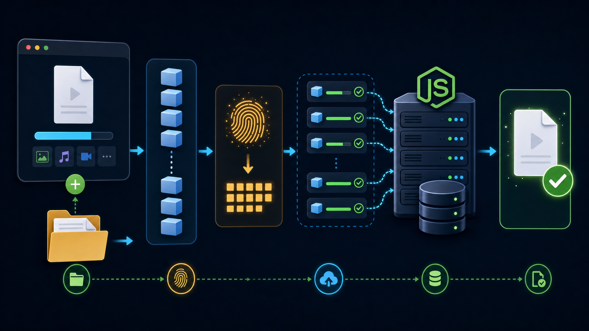

# 大文件上传面试题与参考答案

> 本文结合本项目的 React + Vite 前端、Node.js HTTP 后端、RustFS（S3 兼容对象存储）和《从 0 到 1 实现大文件上传》整理。答案按面试表达习惯分点展开；涉及“本项目”的内容描述的是当前 Demo 实际方案，不等同于唯一的生产实践。

## 一、整体方案与基础概念

### 1. 大文件上传会遇到哪些问题？为什么要做分片上传？

**参考答案：**

- **单次请求不可靠：** 文件越大，请求耗时越长，网络断开、超时或服务重启造成的损失越大；若从头重传，成本很高。
- **服务端资源压力：** 若服务端把整个请求体读入内存再持久化，并发上传可能造成内存飙升；流式接收可降低应用内存占用。
- **用户体验差：** 难以准确展示进度，也不容易实现暂停、重试和恢复。
- **分片的价值：** 把文件拆成独立的小块，每块可单独上传、重试、记录状态；失败时只补传失败或缺失块。
- **本项目：** 以 2 MB 为一个分片；浏览器分片后并发上传，服务端将每个分片保存为 RustFS 对象，最后按序流式合并为 RustFS 中的最终对象。

### 2. 请你描述一下大文件上传的完整流程。

**参考答案：**

1. 用户选择文件，浏览器得到 `File` 对象并做大小、类型等基础校验。
2. 使用 `File.slice()` 按分片大小拆分，并为每片记录 `index`、`size` 和状态。
3. 在 Web Worker 中分块读取文件并计算整体内容 hash。
4. 携带 `fileHash` 请求服务端状态接口：若文件已存在则秒传；否则取得已存在分片列表。
5. 过滤掉已存在分片，只上传缺失分片；控制并发、更新进度、失败重试。
6. 全部分片上传后调用合并接口；服务端校验分片完整性、按序合并并登记文件信息。
7. 返回最终结果，前端刷新文件列表并展示完成状态。

### 3. 分片上传、断点续传、秒传分别是什么？它们有什么关系？

**参考答案：**

- **分片上传：** 将一个文件拆成多个块分别传输，是可靠传输与并发控制的基础。
- **断点续传：** 服务端持久化已收到的分片；恢复时查询状态，仅补传缺失分片。它依赖稳定的文件/任务标识和分片编号。
- **秒传：** 服务端确认相同内容已经存在后，不再重复传输文件数据，只返回已有文件结果。
- **关系：** 分片上传解决“怎么传”；断点续传解决“中断后怎么接着传”；秒传解决“内容已经有了还要不要传”。三者常由文件 hash 和状态查询接口串联。

### 4. 什么是分片上传？结合本项目说说具体实现步骤。

**参考答案：**

- **定义：** 把一个大文件按固定大小切成多个 `Blob`，每片带有稳定编号，分别通过独立请求上传；服务器保存这些分片，全部到齐后再合并。
- **前端切片：** 本项目在 `src/App.tsx` 中使用 2 MiB 的 `CHUNK_SIZE`，按 `start = index * CHUNK_SIZE`、`end = min(start + CHUNK_SIZE, file.size)` 计算范围，通过 `file.slice(start, end)` 生成分片，并创建包含 `index`、`size`、状态和进度的队列项。
- **分片请求：** 每片使用 `FormData` 提交 `fileHash`、`chunkIndex`、`totalChunks`、`totalSize` 等元数据及 `chunk` 文件字段；通过 XHR 上传，受并发数限制，并监听上传进度。
- **服务端接收：** `/api/upload/chunk` 用 Busboy 解析 `multipart/form-data`，再通过 AWS SDK S3 `Upload` 将分片流保存到 RustFS 的 `chunks/<fileHash>/<index>.part` 对象。
- **完成合并：** 前端在所有分片成功或已存在后调用 `/api/upload/merge`；服务端检查缺片，从 RustFS 按编号读取分片流并上传为 `files/<fileHash>.<suffix>`，成功后清理分片对象。
- **面试时可强调：** 分片上传不只是前端 `slice()`，还包括分片编号、并发调度、服务端持久化、完整性检查和合并协议。

### 5. 什么是断点续传？本项目如何做到中断后只上传缺失分片？

**参考答案：**

- **定义：** 上传中断后保留已成功持久化的数据；恢复时根据服务端记录找出缺失分片，只重新上传缺失部分，而不是从头传整个文件。
- **稳定定位：** 本项目用文件内容 MD5 作为 `fileHash`，用 `chunkIndex` 标识该文件的某一片；RustFS 中的对象 key 为 `chunks/<fileHash>/<index>.part`。
- **中断时：** 暂停会中止前端正在进行的 XHR，但已由服务端成功保存的分片保留在 RustFS 中。请求被 abort 时结果可能不确定，因此恢复不能仅信任前端内存中的状态。
- **恢复查询：** 再次选择同一文件后，前端重新计算 hash，并请求 `GET /api/upload/status`，携带 `fileHash`、`totalChunks`、`totalSize` 等信息。服务端返回 `uploadedChunks`。
- **补传缺片：** 前端把 `uploadedChunks` 转成集合，已存在分片标为 `skipped`，只将缺失分片放入并发队列；全部补齐后再调用合并接口。
- **刷新后的边界：** 本项目 `localStorage` 仅保存最近任务的提示信息，不保存可跨刷新复用的浏览器 `File` 对象。刷新后用户要重新选择同一文件；服务端分片清单才是续传状态的权威来源。

### 6. 什么是秒传？本项目如何判断并实现秒传？

**参考答案：**

- **定义：** 用户选择文件后，服务端确认相同内容的完整文件已经存在，客户端无需再次上传文件数据，直接把任务标记完成并返回已有文件信息。
- **内容标识：** 本项目在 Web Worker 中逐片读取文件并计算整体 MD5。相同字节内容得到相同 `fileHash`，因此文件改名后仍可命中已有文件。
- **状态预检：** 前端 hash 计算完成后先请求 `GET /api/upload/status`；服务端根据 `fileHash` 检查最终文件及 metadata 是否已存在。
- **命中处理：** 若服务端返回 `shouldUpload: false`，前端不发送任何 chunk 请求，将分片 UI 标为 `skipped`、进度设为 100%，刷新文件列表并结束任务。
- **未命中处理：** 若 `shouldUpload: true`，则进入普通分片上传流程，并根据 `uploadedChunks` 补齐已有的部分分片；所以“没有完整文件”不等于“所有分片都要重传”。
- **注意事项：** 仅靠客户端声明的 MD5 不能承担权限认证或强安全校验；生产系统还需做用户/租户隔离、服务端校验和摘要策略，避免跨用户越权复用或错误内容命中。

### 7. 为什么不能仅使用文件名作为文件标识？

**参考答案：**

- 文件名可重复，不同文件可能同名。
- 同一文件可以改名，文件名不能证明内容相同。
- 可使用文件内容摘要作为内容标识，并把分片用 `fileHash + chunkIndex` 定位。
- 生产系统还应把用户、租户、业务类型、上传会话等纳入授权和隔离维度，不能因为 hash 相同就无条件共享文件。

## 二、分片、Hash 与浏览器端处理

### 8. 如何计算分片数量和每片的起止位置？最后一片如何处理？

**参考答案：**

- 分片数：`Math.ceil(file.size / chunkSize)`。
- 第 `i` 片起点：`i * chunkSize`；终点：`Math.min(start + chunkSize, file.size)`。
- 使用 `file.slice(start, end)` 得到对应 `Blob`，最后一片自然可以小于标准分片大小。
- 本项目的分片大小是 `2 * 1024 * 1024` 字节，即 2 MiB；示例取值服务于演示，不应视为所有业务的最佳值。

### 9. 分片大小如何选择？越大或越小分别有什么影响？

**参考答案：**

- **太小：** 请求数量、调度开销、服务端元数据和存储操作增加；合并前需要维护更多分片记录。
- **太大：** 单片失败重传成本更高，单次请求耗时更长，进度反馈粒度更粗。
- 应综合文件大小分布、网络质量、并发数、服务端限制、对象存储要求和请求开销，通过压测确定；也可按文件大小动态选择分片大小。
- 生产实现通常设置最小/最大分片大小、最大分片数和单片大小上限，避免恶意请求制造过多小片或超大请求。

### 10. 为什么要计算文件 Hash？MD5 是否等于安全校验？

**参考答案：**

- 内容 hash 可用于识别相同内容、查询上传状态、关联分片和实现去重/秒传。
- 本项目使用 `spark-md5` 计算整个文件内容的 MD5，文件名改变不影响结果。
- **不能把 MD5 当作强安全校验或防篡改证明：** MD5 存在碰撞风险；需要安全完整性校验时可使用 SHA-256 等，并由可信服务端计算/复核或逐片校验摘要。
- 还需考虑“hash 只用于定位、但未验证实际分片内容”的风险。生产系统应验证分片长度/摘要及最终文件摘要，防止错误数据被写入。

### 11. 大文件 Hash 计算为什么放到 Web Worker？

**参考答案：**

- 计算 hash 需要读取大量文件字节，若在主线程同步处理，会占用 UI 线程，造成页面卡顿或无法响应。
- Web Worker 在独立线程中处理计算任务，通过消息把进度和结果发回主线程。
- 本项目逐片读取 `ArrayBuffer`、追加到 `SparkMD5.ArrayBuffer`，并逐片上报 hash 计算进度。
- Worker 不会让计算本身消失；它主要改善界面响应。极大文件仍要关注总 I/O、内存峰值、Worker 取消和资源释放。

### 12. 浏览器刷新后，如何恢复用户的上传任务？

**参考答案：**

- 浏览器出于安全与生命周期限制，刷新后通常不能自动恢复先前页面持有的 `File` 对象。
- 可将任务 ID、文件 hash、已上传分片状态等元数据保存到 `localStorage` 或 IndexedDB；用户重新选择同一文件后重新计算或确认标识，再向服务端查询权威状态。
- 本项目在 `localStorage` 保存最近一次文件的 hash、文件名、大小和分片数量；用户需要重新选择文件，随后重新查询服务端分片状态。
- 客户端记录只能作为提示/缓存，服务端状态才是续传依据；还要处理存储过期、用户切换和任务权限。

## 三、并发、进度、暂停与重试

### 13. 为什么要并发上传？并发数如何控制？

**参考答案：**

- 串行上传利用带宽不足时，并发可让多个分片同时传输，提高链路利用率、缩短总耗时。
- 并发不是越高越好：过高会争抢带宽、增加浏览器连接和服务端负载，也可能造成限流或失败率上升。
- 可用固定数量的 worker/任务池，从待上传队列中取片；并发数应可配置或按网络、失败率动态调节。
- 本项目支持 1 到 6 路并发，页面可以调节；并发调度仍需在暂停、失败、重试期间正确维护每片状态。

### 14. 如何计算上传进度？并发上传时怎样避免进度跳动或倒退？

**参考答案：**

- `XMLHttpRequest.upload.onprogress` 可报告当前请求已发送的字节数；按分片汇总当前已发送字节，可计算整体进度。
- 推荐以字节为基准：`(已确认完成分片字节 + 正在上传分片的实时字节) / 文件总字节`。
- 上传失败或请求被中止时，未确认成功的临时进度应回退/清零，避免重试后进度超过 100% 或倒退混乱。
- 应区分“网络发送进度”和“服务端确认完成进度”：请求进度到 100% 不代表服务端已持久化，只有收到成功响应后才将分片计为完成。
- 本项目使用 XHR 的上传进度事件，并展示整体进度、实时速度和分片状态。

### 15. 为什么本项目用 XMLHttpRequest 上传分片，而不是普通 fetch？

**参考答案：**

- 本项目需要浏览器侧实时监听单个请求的上传进度，使用 `xhr.upload.onprogress` 直接获取进度事件。
- `fetch` 适合常规请求，但上传进度支持与实现细节需要结合具体浏览器和流式方案评估；面试回答应以目标环境实际能力为准。
- 选择 XHR 也要封装超时、取消、错误分类、重试和进度回调，不能只依赖进度事件。

### 16. 如何实现暂停、继续和取消？

**参考答案：**

- 暂停时停止继续派发新分片，并中止正在进行中的请求（本项目通过 `xhr.abort()`）。
- 已经被服务端确认保存的分片不应删除；继续时重新调用状态接口，以服务端记录为准，仅补传缺失片。
- 取消是业务动作，与暂停不同：通常需要取消客户端任务，并视业务要求调用服务端清理接口删除临时分片/上传会话。
- 中止请求存在不确定性：客户端收到 abort 时，服务端可能已经完整收到并写入 RustFS，也可能没有。因此恢复时必须重新查询对象状态，不能只相信前端内存状态。

### 17. 某个分片上传失败怎么办？本项目是怎么处理的？

**参考答案：**

- **单片独立重试：** 不必让整个文件从头上传。网络错误或服务端暂时性错误发生后，只重试失败的分片；生产系统还应按错误类型区分可重试与不可重试错误。
- **本项目的自动重试：** `src/App.tsx` 中每片最多尝试 4 次，即首次请求加 3 次重试；重试等待时间依次为 300 ms、600 ms、900 ms。重试时该片显示 `retrying`，本次请求进度清零。
- **以服务端确认为准：** 只有收到 2xx 响应后，前端才把分片标记为 `success`。XHR 上传进度到 100% 只表示浏览器发送完成，不一定代表 RustFS 已成功保存。
- **重复请求保持同一目标：** 服务端用 `fileHash + chunkIndex` 生成固定对象 key（`chunks/<fileHash>/<index>.part`）。重试写入同一 key，不会把同一分片追加两遍。
- **暂停与恢复：** 用户主动暂停时，XHR abort 会被识别为暂停，不触发自动重试。再次继续或错误后重新开始时，前端查询 `/api/upload/status`，以 RustFS 中实际存在的分片为准，只补传缺失分片。
- **达到上限：** 4 次请求都失败后，该片标记为 `failed`，上传流程显示错误；用户可以再次开始，客户端重新查服务端状态后继续缺失分片。合并接口也会再次检查分片完整性，缺片时返回 `409` 和 `missingChunks`，不会生成不完整的最终对象。
- **当前实现的限制：** 目前所有非 abort 错误都会重试，包括部分 4xx 参数错误；退避是线性递增且没有随机抖动。生产环境应只重试网络错误、限流和可恢复的 5xx，并加入指数退避、随机抖动、总时限和可观测日志。

## 四、服务端接收、合并与可靠性

### 18. 后端如何避免把大文件或分片整体读入内存？

**参考答案：**

- 采用流式解析请求体，并将文件流直接传给后续存储层，避免先聚合成完整 `Buffer`。
- 本项目用 Busboy 解析 `multipart/form-data`，再通过 AWS SDK 的 `Upload` 将分片流写入 RustFS；Node 服务不把分片落到本地磁盘。
- 仍需设置分片大小上限、超时、并发连接限制、用户配额和对象存储容量策略；“流式”只降低单请求内存占用，不等于资源无限。

### 19. 服务端如何保证分片按正确顺序合并？

**参考答案：**

- 每片上传时携带稳定的 `fileHash`、`chunkIndex` 和 `totalChunks` 等信息，服务端按文件任务和分片编号存储。
- 合并前校验分片编号集合完整、数量符合预期，并按 `0...N-1` 的顺序读取，不依赖请求到达顺序或目录枚举顺序。
- 本项目按 `chunks/<fileHash>/<index>.part` 作为 RustFS object key 保存分片，并按下标顺序读取。

### 20. 为什么合并时先写临时文件，再 rename？

**参考答案：**

- 若直接写最终文件，合并中途发生磁盘错误、进程退出或缺片，可能留下看似完整但实际损坏的目标文件。
- 先流式写入 `.tmp`，全部写入成功并完成校验后，再将临时文件原子替换/重命名为最终文件；失败时清理临时文件并保留可恢复的分片。
- **本项目当前不使用本地 `.tmp` 和 `rename`：** 后端将最终对象通过 S3 SDK 上传到 RustFS，上传完成后再返回结果。对象存储上传的失败恢复语义与本地文件系统原子 rename 不同；若需要严格的发布原子性，应采用临时 object key，验证后再切换/复制到正式 key，并设计失败清理。

### 21. 什么是合并锁？为什么需要它？

**参考答案：**

- 用户重复点击、客户端重试或并发请求可能导致同一文件同时触发多次合并。
- 对同一上传任务加互斥锁，避免两个合并过程互相覆盖或重复清理分片。
- 本项目用 Node 进程内的内存锁，适用于单进程 Demo。
- 多进程/多实例部署时，进程内锁无法互斥其他实例，应使用 Redis 锁、数据库锁或任务队列，并处理锁过期、续租和幂等结果。

### 22. 如果服务端缺少某个分片，合并接口应该怎么做？

**参考答案：**

- 合并前检查所有期望分片是否存在，并核对数量、大小或摘要。
- 缺片时返回明确错误及缺失分片编号，不生成最终文件；客户端可查询状态并补传。
- 合并应幂等：已经完成的任务重复请求时返回已有结果，避免重新破坏文件。
- 本项目的后端测试覆盖缺失分片和幂等合并场景。

### 23. 如何保证上传接口幂等？

**参考答案：**

- 定义稳定幂等键，例如 `uploadId + chunkIndex`；重复上传同一片可以覆盖同一临时目标或校验后返回已完成，不应追加重复字节。
- 对合并请求保持幂等：最终对象已存在时返回已有结果，并可补做临时分片对象清理。
- 同一分片 key 的重传会覆盖该对象；多实例场景仍需结合会话状态、校验和及分布式协调处理并发写入。
- 还需校验同一个 uploadId/hash 对应的文件大小、分片总数和用户归属，不能只根据客户端给出的 hash 信任请求。

## 五、安全、扩展与项目理解

### 24. 大文件上传需要考虑哪些安全问题？

**参考答案：**

- 文件名、hash、分片下标等均为不可信输入；校验格式和取值范围，禁止路径穿越。
- 限制文件大小、单片大小、分片数、并发数、会话数量、用户配额和上传速率，防止资源耗尽。
- 做身份认证、权限校验、租户隔离；不要仅凭 hash 允许读取或覆盖他人文件。
- 校验扩展名、MIME 和实际文件内容；按业务做恶意文件扫描，下载时设置安全响应头。
- 本项目会清理文件名、后缀和 hash，并校验分片编号，再构造 RustFS object key；不再使用本地路径，因此没有 `ensureInside()` 文件路径边界检查。仍应补充认证授权、配额及对象 key 的用户/租户隔离。

### 25. 如果上传服务部署成多台机器，现有方案有哪些问题？

**参考答案：**

- 分片和最终对象已放在共享的 RustFS 中，因此不同实例可以访问同一对象数据；但当前合并锁是进程内锁，多实例间不共享，上传会话元数据和任务并发仍需数据库/Redis 等协调。会话粘性不能解决机器故障与扩缩容问题。
- 锁、任务状态转换和合并任务需要跨实例协调，并设计幂等、超时恢复和清理机制。
- 更常见的生产架构是业务服务负责鉴权、签发短期凭证和管理元数据，浏览器直接分片上传到对象存储，完成后由服务端校验并确认合并。

### 26. 如果要进一步改成浏览器直传对象存储，还需要做什么？

**参考答案：**

1. 浏览器向业务后端申请上传会话，后端完成身份、权限、配额与文件策略校验。
2. 后端创建对象存储 multipart upload 会话，返回受限、短时有效的分片上传凭证或预签名 URL。
3. 浏览器并发上传分片，记录每片的 ETag/校验信息；失败时只重传失败分片。
4. 客户端提交完成请求；后端核验会话所有权、分片列表和 ETag，再调用存储服务完成合并。
5. 后端登记最终对象并返回业务文件 ID；失败/过期会话通过生命周期策略清理。
6. 不能把长期云密钥放在浏览器；还要评估 CORS、费用、分片最小大小、未完成 multipart 清理和安全扫描。

### 27. 如何测试大文件上传方案？

**参考答案：**

- **功能：** 空文件、刚好一片、最后一片不足、重复分片、秒传、缺片合并、顺序正确。
- **异常：** 网络断开、超时、服务端重启、对象存储写入失败、重复合并、暂停时请求竞态、重试耗尽。
- **完整性：** 合并后比较文件大小和摘要，确认字节内容与原文件一致。
- **安全：** 非法 hash/分片编号、路径穿越、超限请求、越权任务、恶意文件类型。
- **性能：** 不同文件大小、分片大小、并发数下的吞吐、内存、CPU、对象存储读写量、失败率和恢复时间。
- 本项目的 `npm test` 使用 mock S3 客户端覆盖分片存储、合并、缺失分片和幂等处理；它不是连接真实 RustFS 的集成测试。另可用 `npm run build` 和 `npm run typecheck` 检查前端构建与类型。

## 六、面试总结表达

### 28. 请用 1 分钟总结你对大文件上传的理解。

**参考答案：**

> 我会把大文件上传拆成“切片、识别、查询、传输、合并”五个环节。前端用 `File.slice()` 产生带编号的分片，在 Web Worker 中计算内容 MD5；上传前先向服务端查询 RustFS 中的最终对象和已有分片，实现秒传与断点续传。随后用受控并发上传缺失分片，按片展示进度，并对可恢复错误做有限重试。服务端通过 Busboy 流式接收分片，再用 S3 SDK 写入 RustFS；确认分片齐全后按编号流式读取并上传最终对象，成功后清理临时分片。暂停或网络中断后重新查询服务端状态。生产化仍需补齐用户授权、租户隔离、多实例合并协调、配额、安全校验、过期清理和可观测性。

## 附：项目实现速查

| 项目点 | 当前实现 |
| --- | --- |
| 前端 | React + Vite，核心页面 `src/App.tsx` |
| 分片大小 | 2 MiB |
| Hash | `spark-md5` 计算整文件 MD5，位于 `src/workers/hashWorker.ts` |
| 实时上传进度 | `XMLHttpRequest.upload.onprogress` |
| 并发 | 1–6 路可调 |
| 重试 | 单片最多自动重试 3 次，并有短暂退避 |
| 暂停 | 中止当前 XHR；继续前重新查询服务端状态 |
| 后端 | Node.js 原生 HTTP，`server/index.js`、`server/storage.js` |
| 分片解析/写入 | Busboy 流式解析 multipart，再通过 AWS SDK S3 Upload 写入 RustFS |
| 接口 | `GET /api/upload/status`、`POST /api/upload/chunk`、`POST /api/upload/merge` |
| 对象 key | `chunks/<fileHash>/<index>.part`；最终对象 `files/<fileHash>.<suffix>` |
| 合并 | 从 RustFS 按序读取分片流并上传最终对象，成功后删除分片对象 |
| 重要边界 | 数据存 RustFS；进程内合并锁不适合多实例；客户端 MD5 不是安全授权凭据 |

## 参考题型来源

对象存储直传是可选的后续架构方向；当前 Demo 仍由 Node 后端中转分片到 RustFS。题目组织参考了公开面试题中反复出现的考察方向：上传挑战与断点续传、分片与并发、Hash/秒传、服务端合并，以及生产场景中的对象存储直传和安全授权。本文答案按当前仓库代码与项目说明重新整理，并非对外部题库答案的照搬。
