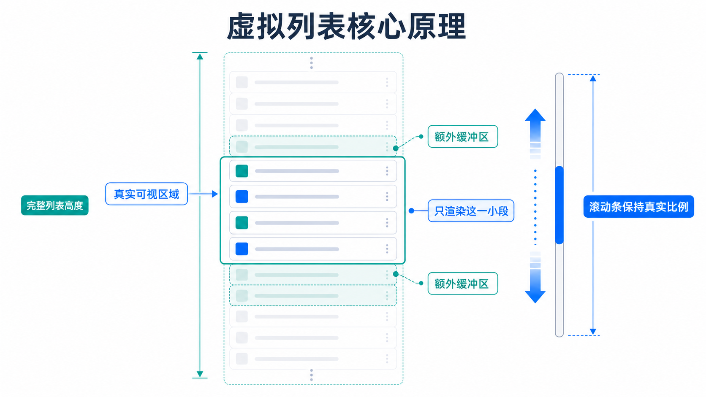
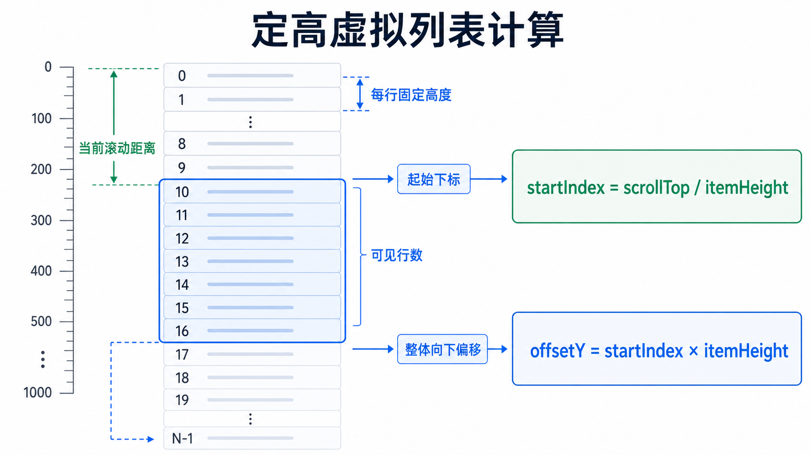
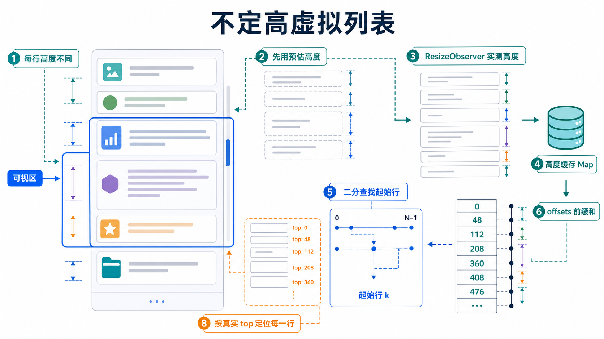
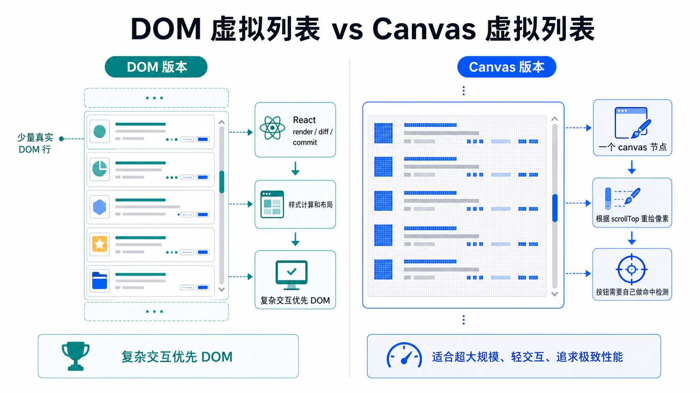

# 从 0 到 1 理解 React 虚拟列表：定高、不定高与 Canvas 版本完整拆解

> 本文基于当前项目 `react-virtual-list-demo` 编写。目标读者是刚接触虚拟列表的前端同学：你不需要先懂复杂性能优化，也不需要先看过 `react-window` 或 `@tanstack/react-virtual` 的源码。读完这篇文章后，你应该能明白虚拟列表为什么存在、定高虚拟列表怎么计算、不定高虚拟列表为什么更难、Canvas 版本为什么可能更快，以及这个项目里的代码是如何一步步把这些想法落地的。

## 一、为什么普通列表会卡

我们先从最朴素的写法开始。假设后端返回了 10,000 条商品数据，每条商品都有图片、标题、摘要、标签、状态、价格、负责人和几个操作按钮。很多初学者第一次写列表时会这样做：

```tsx
{items.map((item) => (
  <ProductRow key={item.id} item={item} />
))}
```

这段代码看起来很自然：有多少数据，就渲染多少行。数据量只有几十条、几百条时，这样写通常没有问题。但当数据变成 10,000 条时，问题就会集中出现。

首先，浏览器要创建大量 DOM 节点。一行商品不是一个简单的 `div`，它里面可能有 `article`、`img`、`h2`、`p`、多个 `span`、多个 `button`，按钮里还可能有 SVG 图标。假设每一行有 20 个 DOM 节点，10,000 行就是 200,000 个 DOM 节点。浏览器维护这些节点需要内存，也需要时间。

其次，浏览器要给这些节点计算样式。CSS 选择器、布局规则、字体、图片尺寸、边距、边框、响应式规则，都会参与计算。节点越多，样式计算和布局成本越高。

第三，React 也要参与工作。React 需要执行组件函数、生成虚拟 DOM、做 diff，再把变化提交到真实 DOM。即使某次更新只改了搜索关键词或者 loading 状态，React 仍然要面对一个很大的组件树。

最后，用户实际看到的内容很少。一个 560px 高的滚动容器，如果每行 92px，屏幕里同时看到的商品大概也就 7 行左右。哪怕加上上下缓冲，也只需要渲染二十多行。也就是说，10,000 条数据里绝大多数内容此刻并不在用户眼前，却仍然被浏览器创建、布局和维护了。

虚拟列表解决的就是这个浪费：**数据可以有 10,000 条，但 DOM 不必有 10,000 行。**

## 二、虚拟列表的核心想法

虚拟列表的英文通常叫 virtual list 或 virtualized list。它的核心思想非常简单：

```text
只渲染用户当前能看到的那一小段列表。
```

如果用户往下滚动，我们就把这一小段 DOM 换成新的数据。如果用户继续往上滚动，我们再换回上面的数据。用户感觉自己在浏览一个完整的长列表，但浏览器实际维护的 DOM 数量一直很少。

下面这张图展示了虚拟列表的基本结构。



图里有几个关键概念：

- **完整列表高度**：虽然我们不渲染全部 DOM，但仍然要让滚动条看起来像真的有 10,000 行。
- **真实可视区域**：用户当前能看到的窗口，也就是滚动容器的高度。
- **额外缓冲区**：为了避免滚动时刚好看到空白，通常会在可视区域上方和下方多渲染几行。
- **只渲染这一小段**：React 真正创建的 DOM 只来自这段数据。
- **滚动条保持真实比例**：用户拖动滚动条时，体验仍然像在操作完整列表。

这里最容易困惑的一点是：如果没有渲染全部行，滚动条为什么还能那么长？

答案是：我们会创建一个“撑高元素”。这个元素不负责展示内容，只负责提供总高度。例如定高列表里每一行 92px，总共有 10,000 行，那么总高度就是：

```ts
const totalHeight = items.length * itemHeight;
```

也就是：

```text
10,000 × 92 = 920,000px
```

滚动容器里放一个高度为 920,000px 的空元素，浏览器就会生成一个真实比例的滚动条。然后我们把真正渲染的二十多行内容放在这个巨大空间里的正确位置。

这就是虚拟列表最重要的两件事：

1. 用撑高元素制造完整滚动体验。
2. 用少量真实 DOM 展示当前可见内容。

## 三、当前项目实现了什么

当前项目 `react-virtual-list-demo` 不是只写了一个最简单版本，而是做了三个入口：

- `/`：定高 DOM 虚拟列表。
- `/variable`：不定高 DOM 虚拟列表。
- `/canvas`：Canvas 虚拟列表对比版本。

项目入口在 `src/App.tsx`。页面加载时，会调用 `fetchProductList` 模拟接口，请求 10,000 条商品数据：

```ts
fetchProductList({ count: 10000, delayMs: 650, signal })
```

这里没有直接同步生成数据，而是模拟了一个真实接口。它会延迟一段时间返回数据，并且支持 `AbortController` 取消请求。这让 demo 更接近真实业务：页面会有 loading、error、retry、搜索过滤和列表展示。

数据类型定义在 `src/data/products.ts`：

```ts
export type FeedItem = {
  id: number;
  title: string;
  summary: string;
  imageUrl: string;
  imageAlt: string;
  tags: string[];
  status: '热销' | '新品' | '补货中';
  owner: string;
  updatedAt: string;
  price: string;
};
```

可以看到，每一行不是纯文本，而是比较接近真实电商后台或商品列表的复杂行。这样做的好处是：虚拟列表的收益更明显，也更容易暴露实际开发中会遇到的问题，比如图片加载、标签换行、按钮交互、响应式布局、滚动白屏等。

## 四、定高虚拟列表：最适合入门的版本

我们先看最简单、也最适合入门的版本：定高虚拟列表。

定高的意思是：每一行高度固定。当前项目里定高列表每行是 92px：

```tsx
<FixedSizeVirtualList
  className="virtual-list"
  items={filteredItems}
  itemHeight={92}
  height={560}
  overscan={8}
  getItemKey={(item) => item.id}
  renderItem={(item) => (...)}
/>
```

它的实现文件是：

```text
src/components/FixedSizeVirtualList.tsx
```

定高列表为什么简单？因为只要知道 `scrollTop` 和 `itemHeight`，我们就能直接算出用户滚到了第几行附近。

如果每行高度是 92px，用户滚动了 920px，那么大概就在第 10 行：

```text
920 / 92 = 10
```

如果用户滚动了 9,250px，那么大概在第 100 行附近：

```text
9250 / 92 ≈ 100
```

这就是定高虚拟列表最核心的计算。



项目里的代码是这样写的：

```ts
const totalHeight = items.length * itemHeight;
const visibleCount = Math.ceil(height / itemHeight);
const startIndex = clamp(
  Math.floor(scrollTop / itemHeight) - overscan,
  0,
  items.length
);
const endIndex = clamp(
  startIndex + visibleCount + overscan * 2,
  startIndex,
  items.length
);
const offsetY = startIndex * itemHeight;
```

逐行解释一下。

`totalHeight` 是完整列表高度：

```ts
const totalHeight = items.length * itemHeight;
```

这个值用于撑开滚动条。如果有 10,000 条，每条 92px，那么总高度就是 920,000px。

`visibleCount` 是可视区域最多能放下多少行：

```ts
const visibleCount = Math.ceil(height / itemHeight);
```

当前列表高度是 560px，每行 92px：

```text
560 / 92 ≈ 6.08
```

向上取整就是 7 行。因为最后一行哪怕只露出一点，也应该算作可见行。

`startIndex` 是开始渲染的下标：

```ts
Math.floor(scrollTop / itemHeight) - overscan
```

假设 `scrollTop = 920`，`itemHeight = 92`，那么当前视口顶部落在第 10 行。但我们不会只从第 10 行开始渲染，而是会往上多渲染 `overscan` 行。这样用户向上轻微滚动时，不会马上看到空白。

`endIndex` 是结束渲染的下标：

```ts
startIndex + visibleCount + overscan * 2
```

这里加了两倍 `overscan`，表示可视区域上方和下方都要有缓冲。

最后，`offsetY` 表示真实渲染窗口要整体向下移动多少：

```ts
const offsetY = startIndex * itemHeight;
```

因为前面很多行没有创建 DOM，但它们在视觉上仍然占据空间。我们要把当前渲染出来的第一行移动到它原本应该出现的位置。

## 五、定高列表的 DOM 结构

定高虚拟列表的 DOM 结构大概是这样：

```tsx
<div className="virtual-list" style={{ height }} onScroll={handleScroll}>
  <div className="virtual-list__spacer" style={{ height: totalHeight }}>
    <div
      className="virtual-list__window"
      style={{ transform: `translateY(${offsetY}px)` }}
    >
      {visibleItems.map(...)}
    </div>
  </div>
</div>
```

外层 `.virtual-list` 是滚动容器，它有固定高度，也就是用户真正看到的窗口。

中间 `.virtual-list__spacer` 是撑高元素，它的高度等于完整列表高度。它让滚动条正常工作。

里面 `.virtual-list__window` 是真实渲染窗口。它只包含当前要渲染的那一小段行，并通过 `transform: translateY(...)` 移动到正确位置。

对应的 CSS 也很关键：

```css
.virtual-list {
  overflow: auto;
  scrollbar-gutter: stable;
}

.virtual-list__spacer {
  position: relative;
}

.virtual-list__window {
  position: absolute;
  top: 0;
  right: 0;
  left: 0;
  will-change: transform;
}
```

这里 `.virtual-list__window` 用了绝对定位。它不会参与普通文档流，而是被放在撑高空间里的指定位置。这样前面没有渲染的几千行不会真的占 DOM，但视觉位置仍然正确。

每一行外层还有一个固定高度：

```tsx
<div
  className="virtual-list__row"
  key={getItemKey(item, index)}
  style={{ height: itemHeight }}
  role="listitem"
  aria-posinset={index + 1}
  aria-setsize={items.length}
>
  {renderItem(item, index)}
</div>
```

这里 `height: itemHeight` 很重要。定高虚拟列表必须保证每一行真实高度和计算高度一致。如果 CSS 里内容撑高了行，或者图片加载后把行高撑大，计算就会错位。

## 六、为什么需要 overscan

如果我们只渲染刚好可见的行，会不会更省性能？

理论上是的，但体验会差。因为滚动发生时，浏览器先改变 `scrollTop`，然后 React 才收到滚动事件，再计算新的可见范围，再提交 DOM 更新。这个过程存在时间差。

如果用户滚动很快，视口可能已经进入下一段区域，但 React 还没来得及把下一段行渲染出来。这时用户可能看到短暂空白。

`overscan` 就是为了解决这个问题。它会在可视区域外多渲染一些行：

```text
上方缓冲区 + 可视区域 + 下方缓冲区
```

当前定高版本传入的是：

```tsx
overscan={8}
```

如果视口能显示 7 行，那么实际渲染行数大概是：

```text
8 + 7 + 8 = 23 行
```

也就是说，虽然数据有 10,000 条，但页面上真实 DOM 行大约只有二十多行。这个数量足够小，滚动时 React 和浏览器的压力会低很多。

`overscan` 不是越大越好。它是一种取舍：

- 太小：快速滚动时容易看到空白。
- 太大：每次滚动要渲染更多行，性能收益下降。

真实业务里可以根据场景调整。列表行很复杂、图片很多时，`overscan` 不宜过大；如果行很简单、设备性能好，可以适当加大缓冲。

## 七、为什么要用 requestAnimationFrame 合并滚动更新

滚动事件触发非常频繁。用户拖动滚动条或触控板快速滑动时，一秒内可能触发很多次 `scroll`。如果每一次都直接 `setScrollTop`，React 会收到大量状态更新，滚动过程可能变得更忙。

当前项目使用了 `requestAnimationFrame` 做合帧：

```ts
const handleScroll = useCallback((event: UIEvent<HTMLDivElement>) => {
  pendingScrollTopRef.current = event.currentTarget.scrollTop;

  if (animationFrameRef.current !== null) {
    return;
  }

  animationFrameRef.current = window.requestAnimationFrame(() => {
    animationFrameRef.current = null;
    const nextScrollTop = pendingScrollTopRef.current;

    setScrollTop(currentScrollTop =>
      currentScrollTop === nextScrollTop ? currentScrollTop : nextScrollTop
    );
  });
}, []);
```

这段代码的意思是：一帧内不管滚动事件触发多少次，只记住最新的 `scrollTop`，然后等浏览器下一帧统一更新 React 状态。

可以把它理解成排队：

```text
滚动事件 1：scrollTop = 100
滚动事件 2：scrollTop = 130
滚动事件 3：scrollTop = 180
下一帧：只提交 180
```

这样可以减少无意义更新。用户不关心中间那些已经过期的位置，用户只关心当前最新位置。

组件卸载时还会取消未执行的帧：

```ts
useEffect(() => {
  return () => {
    if (animationFrameRef.current !== null) {
      window.cancelAnimationFrame(animationFrameRef.current);
    }
  };
}, []);
```

这是一个很好的习惯。否则组件卸载后，排队中的回调仍然可能执行，造成不必要的状态更新。

## 八、定高虚拟列表的优点和限制

定高虚拟列表非常适合作为入门版本，因为它的数学模型简单：

```text
下标 = 滚动距离 / 行高
```

它的优点很明显：

- 实现简单。
- 计算快。
- 不需要测量 DOM。
- 滚动位置稳定。
- 适合表格、订单列表、消息列表、商品列表等行高固定的场景。

但它也有一个强限制：每一行高度必须固定。

如果某些商品标题换成两行，某些标签换行，某些行有更多描述，行高就不再固定。这时再用 `scrollTop / itemHeight` 算下标，就会出错。

举个例子。假设你以为每行都是 100px，但真实情况是：

```text
第 0 行：80px
第 1 行：120px
第 2 行：160px
第 3 行：90px
```

当 `scrollTop = 200` 时，用固定行高算：

```text
200 / 100 = 2
```

你会以为视口顶部在第 2 行。但真实累计高度是：

```text
第 0 行结束：80
第 1 行结束：200
第 2 行开始：200
```

这个例子刚好还对。如果换一个滚动位置，就可能偏差越来越大。数据越多，误差越明显。

所以，只要行高可能变化，就要进入下一个话题：不定高虚拟列表。

## 九、不定高虚拟列表为什么更难

不定高虚拟列表的难点在于：我们不能再用一个固定公式直接算出行号。

定高时：

```text
第 100 行顶部 = 100 × itemHeight
```

不定高时：

```text
第 100 行顶部 = 第 0 行高度 + 第 1 行高度 + ... + 第 99 行高度
```

也就是说，我们必须知道前面所有行的累计高度。

当前项目的不定高版本入口是 `/variable`，组件文件是：

```text
src/components/VariableSizeVirtualList.tsx
```

页面里为了制造不定高效果，给每一行追加了不同数量的详情段落和标签：

```ts
function getVariableDetails(item: FeedItem, index: number) {
  const detailCount = (index % 4) + 1;
  ...
  return details.slice(0, detailCount);
}
```

有的行只有一段详情，有的行有四段详情；有的标签少，有的标签多。这样行高自然就不同。

不定高虚拟列表的整体策略是：

1. 一开始不知道真实高度，先用预估高度。
2. 行渲染出来后，用 `ResizeObserver` 测量真实高度。
3. 把真实高度缓存起来。
4. 根据缓存重新计算每一行的累计偏移。
5. 滚动时用二分查找找到起始行。
6. 每一行根据自己的 `top` 单独定位。

下面这张图展示了这条链路。



## 十、offsets 前缀和是什么

不定高虚拟列表里最重要的数据结构叫 `offsets`。项目里有这样一段注释：

```ts
// offsets[index] 表示第 index 行顶部距离列表顶部的累计高度。
```

它的含义可以这样理解：

```text
offsets[0] = 第 0 行顶部位置 = 0
offsets[1] = 第 1 行顶部位置 = 第 0 行高度
offsets[2] = 第 2 行顶部位置 = 第 0 行高度 + 第 1 行高度
offsets[3] = 第 3 行顶部位置 = 第 0 行高度 + 第 1 行高度 + 第 2 行高度
```

假设前几行高度分别是：

```text
第 0 行：48px
第 1 行：64px
第 2 行：96px
第 3 行：152px
```

那么 `offsets` 就是：

```text
offsets[0] = 0
offsets[1] = 48
offsets[2] = 112
offsets[3] = 208
offsets[4] = 360
```

也就是说，`offsets[index]` 直接告诉我们第 `index` 行应该从哪里开始。

项目里的计算代码是：

```ts
const offsets = useMemo(() => {
  const nextOffsets = new Array<number>(items.length + 1);
  nextOffsets[0] = 0;

  for (let index = 0; index < items.length; index += 1) {
    const item = items[index];
    const itemKey = getItemKey(item, index);
    const measuredHeight = measuredHeightsRef.current.get(itemKey);
    nextOffsets[index + 1] =
      nextOffsets[index] + (measuredHeight ?? estimatedItemHeight);
  }

  return nextOffsets;
}, [estimatedItemHeight, getItemKey, items, measurementVersion]);
```

这里有一个关键点：

```ts
measuredHeight ?? estimatedItemHeight
```

如果某一行已经测量过，就用真实高度；如果还没有测量过，就先用预估高度。

这是不定高虚拟列表必须接受的现实：刚开始你不可能知道所有未渲染行的真实高度。只有某一行被渲染到 DOM 里，你才有机会测量它。

## 十一、为什么需要 ResizeObserver

要测量一个 DOM 元素的高度，最直接的方法是：

```ts
row.getBoundingClientRect().height
```

当前项目在 `MeasuredRow` 组件里做了这件事：

```ts
const reportSize = () => {
  onSizeChange(itemKey, row.getBoundingClientRect().height);
};

reportSize();

const observer = new ResizeObserver(reportSize);
observer.observe(row);
```

这里有两层考虑。

第一，行首次挂载后立即测量一次：

```ts
reportSize();
```

这样可以尽快把预估高度修正为真实高度。

第二，使用 `ResizeObserver` 继续监听：

```ts
const observer = new ResizeObserver(reportSize);
observer.observe(row);
```

为什么还要继续监听？因为行高可能在挂载后发生变化。比如图片加载完成、标签换行、字体加载完成、容器宽度变化、用户展开详情等，都可能让高度变化。

`ResizeObserver` 可以在元素尺寸变化时通知我们，然后更新高度缓存。

更新缓存的逻辑是：

```ts
const handleSizeChange = useCallback((itemKey, measuredHeight) => {
  if (!Number.isFinite(measuredHeight) || measuredHeight <= 0) {
    return;
  }

  const roundedHeight = Math.ceil(measuredHeight);
  const previousHeight = measuredHeightsRef.current.get(itemKey);

  if (previousHeight !== undefined && Math.abs(previousHeight - roundedHeight) < 1) {
    return;
  }

  measuredHeightsRef.current.set(itemKey, roundedHeight);
  setMeasurementVersion((version) => version + 1);
}, []);
```

这里用 `Map` 保存高度：

```ts
const measuredHeightsRef = useRef(new Map<string | number, number>());
```

为什么不用 state 直接保存 `Map`？

因为测量变化可能很频繁。如果每次都创建新的 `Map` 并放到 state，成本会更高。这里把 `Map` 放在 ref 里，真正需要触发重新计算时，只更新一个版本号：

```ts
setMeasurementVersion((version) => version + 1);
```

`measurementVersion` 改变后，`useMemo` 会重新计算 `offsets`。

## 十二、为什么不定高要用二分查找

定高列表可以这样算起始行：

```ts
Math.floor(scrollTop / itemHeight)
```

不定高列表不能这样做。它只能通过 `offsets` 判断：当前 `scrollTop` 落在哪两行顶部之间。

例如：

```text
offsets = [0, 48, 112, 208, 360, 408]
scrollTop = 230
```

230 大于 208，小于 360，所以视口顶部落在第 3 行。

如果我们从头遍历：

```text
从 offsets[0] 查到 offsets[n]
```

每次滚动都可能要扫很多数据。10,000 行还勉强可以，但如果数据更多，或者滚动很频繁，就不够优雅。

因为 `offsets` 是递增数组，所以可以用二分查找。项目里的代码是：

```ts
function findStartIndex(offsets: number[], scrollTop: number) {
  let low = 0;
  let high = offsets.length - 1;

  while (low < high) {
    const mid = Math.floor((low + high + 1) / 2);

    if (offsets[mid] <= scrollTop) {
      low = mid;
    } else {
      high = mid - 1;
    }
  }

  return clamp(low, 0, Math.max(offsets.length - 2, 0));
}
```

二分查找的好处是查找次数很少。10,000 条数据，用二分大约只需要十几次比较，而不是几千次。

找到基础起始行后，仍然要加上 `overscan`：

```ts
const baseStartIndex = findStartIndex(offsets, scrollTop);
const startIndex = clamp(baseStartIndex - overscan, 0, items.length);
```

终点不能像定高那样直接用 `visibleCount` 算，因为每行高度不同。所以项目里使用 `while` 往后推进，直到超过视口底部：

```ts
let baseEndIndex = baseStartIndex;
const viewportBottom = scrollTop + height;

while (baseEndIndex < items.length && offsets[baseEndIndex] < viewportBottom) {
  baseEndIndex += 1;
}

const endIndex = clamp(baseEndIndex + overscan, startIndex, items.length);
```

这段逻辑的意思是：从起始行开始往后找，只要行顶部还没有超过视口底部，就说明它可能可见。找到可见范围后，再额外加上缓冲区。

## 十三、不定高列表为什么每一行要单独定位

定高版本里，所有可见行放在一个窗口中，窗口整体 `translateY(offsetY)`：

```tsx
<div
  className="virtual-list__window"
  style={{ transform: `translateY(${offsetY}px)` }}
>
  ...
</div>
```

因为每行一样高，窗口内部自然从上到下排列即可。

不定高版本则不同。每一行顶部位置都来自 `offsets[index]`，所以每一行要单独定位：

```tsx
<MeasuredRow
  top={offsets[index]}
  ...
/>
```

`MeasuredRow` 内部这样写：

```tsx
<div
  ref={rowRef}
  className="variable-list__row"
  style={{ transform: `translateY(${top}px)` }}
>
  {renderItem(item, index)}
</div>
```

对应 CSS：

```css
.variable-list__row {
  position: absolute;
  top: 0;
  right: 0;
  left: 0;
  padding: 0 18px;
  border-bottom: 1px solid var(--color-border);
  will-change: transform;
}
```

也就是说，不定高列表里每一行都是绝对定位，然后根据自己的累计高度放到对应位置。

这种方案比定高复杂，但它能支持真实业务里常见的动态内容：多行文案、展开收起、不同数量标签、不同图片比例等。

## 十四、不定高列表的误差和修正

不定高虚拟列表最容易让初学者疑惑的是：既然一开始很多行都没有测量过，滚动条会不会不准？

答案是：一开始确实只是估算，后面会逐步修正。

当前项目传入了：

```tsx
estimatedItemHeight={148}
```

也就是说，未测量的行先按 148px 估算。随着用户滚动，越来越多行被渲染出来，`ResizeObserver` 会测量真实高度，`measuredHeightsRef` 里真实数据越来越多，`offsets` 也越来越准确。

这种方式在工程上很常见。它不是一开始就完美，而是通过“预估 + 实测 + 缓存 + 修正”逐步逼近真实布局。

如果预估高度差太多，会带来几个问题：

- 滚动条长度一开始不准确。
- 滚动到某些位置时内容可能跳动。
- 快速跳到很远位置时，误差更明显。

所以预估高度要尽量接近平均行高。比如当前不定高商品行大概在 120px 到 220px 之间，选择 148px 就是一个相对合理的起点。

如果业务里不定高差异极大，常见优化方式有：

- 按类型设置不同预估高度。
- 服务端提前返回内容长度或行高估计。
- 首屏先测一批样本，动态调整平均高度。
- 使用成熟库处理滚动锚点和高度修正。

## 十五、Canvas 虚拟列表：为什么它看起来更快

第三个入口是 `/canvas`，实现文件是：

```text
src/components/CanvasVirtualList.tsx
```

Canvas 版本依然是虚拟列表，但它不再把每一行渲染成 DOM。它的核心结构更像这样：

```tsx
<div className="canvas-list" onScroll={handleScroll}>
  <div className="canvas-list__spacer" style={{ height: totalHeight }}>
    <canvas ref={canvasRef} />
  </div>
</div>
```

滚动容器仍然存在，撑高元素仍然存在，滚动条仍然是真实的。但列表内容不是 DOM 行，而是画到同一个 `canvas` 上。

下面这张图对比了 DOM 虚拟列表和 Canvas 虚拟列表的渲染路径。



DOM 虚拟列表虽然只渲染二十多行，但每行内部仍然有很多节点：

- 图片。
- 标题。
- 摘要。
- 标签。
- 状态。
- 价格。
- 按钮。
- SVG 图标。

滚动时，React 需要更新可见行，浏览器需要做样式计算、布局、绘制和合成。

Canvas 版本的核心节点只有一个 `canvas`。滚动时，它根据 `scrollTop` 算出可见范围，然后用 Canvas API 把当前可见行画出来：

```ts
ctx.clearRect(0, 0, width, height);
ctx.fillRect(0, 0, width, height);
ctx.drawImage(image, 18, rowY + 22, 64, 48);
ctx.fillText(item.title, contentX, rowY + 27);
```

这就是 Canvas 版本可能更快的原因：它减少了大量 DOM 节点管理和布局计算。

不过要注意，Canvas 不是“无脑更好”。Canvas 画出来的按钮只是像素，不是原生按钮。用户点击时，浏览器并不知道那里有一个按钮。项目里必须自己记录按钮区域：

```ts
nextHitAreas.push({
  itemId: item.id,
  label,
  x: actionX,
  y: actionY,
  width: 44,
  height: 44,
});
```

点击时再手动判断鼠标落在哪个区域：

```ts
const hitArea = hitAreasRef.current.find(
  (area) =>
    x >= area.x &&
    x <= area.x + area.width &&
    y >= area.y &&
    y <= area.y + area.height
);
```

这就是 Canvas 的代价：性能上限更高，但交互和可访问性都要自己实现。

## 十六、Canvas 版本如何绘制当前窗口

Canvas 版本仍然是定高列表，所以可见范围计算和定高 DOM 版本类似：

```ts
const totalHeight = items.length * itemHeight;
const visibleCount = Math.ceil(height / itemHeight);
const startIndex = clamp(
  Math.floor(scrollTop / itemHeight) - overscan,
  0,
  items.length
);
const endIndex = clamp(
  startIndex + visibleCount + overscan * 2,
  startIndex,
  items.length
);
```

真正不同的是绘制。每一帧里，它会遍历可见范围：

```ts
for (let index = startIndex; index < endIndex; index += 1) {
  const item = items[index];
  const rowY = index * itemHeight - scrollTop;
  ...
}
```

`rowY` 是这一行在当前画布上的 y 坐标。注意这里不是 `index * itemHeight`，而是：

```ts
index * itemHeight - scrollTop
```

因为 canvas 是固定在可视区域里的。用户滚动后，画布本身不跟着长列表移动，而是始终贴在视口顶部。我们要把内容画到相对于当前视口的位置。

然后它会画背景、分割线、图片、标题、摘要、标签、状态、价格和模拟按钮。

例如圆角矩形需要自己画：

```ts
function roundedRect(ctx, x, y, width, height, radius) {
  ctx.beginPath();
  ctx.moveTo(x + safeRadius, y);
  ctx.arcTo(x + width, y, x + width, y + height, safeRadius);
  ...
  ctx.closePath();
}
```

文本省略也要自己做。DOM 里可以用 CSS：

```css
text-overflow: ellipsis;
white-space: nowrap;
```

Canvas 里没有这种自动能力，所以项目实现了 `ellipsize`：

```ts
function ellipsize(ctx, text, maxWidth) {
  if (ctx.measureText(text).width <= maxWidth) {
    return text;
  }

  let left = 0;
  let right = text.length;

  while (left < right) {
    const mid = Math.ceil((left + right) / 2);
    const candidate = `${text.slice(0, mid)}...`;

    if (ctx.measureText(candidate).width <= maxWidth) {
      left = mid;
    } else {
      right = mid - 1;
    }
  }

  return `${text.slice(0, left)}...`;
}
```

这个函数用二分查找找到能放进指定宽度的最长文本，再加上省略号。

## 十七、图片加载为什么要缓存

商品列表里有图片。DOM 版本可以直接写：

```tsx

```

Canvas 版本不能直接把 URL 写进画布，它需要先创建图片对象：

```ts
const image = new Image();
image.decoding = 'async';
image.src = item.imageUrl;
```

当前项目用 `imageCacheRef` 缓存图片：

```ts
const imageCacheRef = useRef(new Map<string, HTMLImageElement>());
```

预加载逻辑是：

```ts
const preloadImages = useCallback((startIndex, endIndex) => {
  for (let index = startIndex; index < endIndex; index += 1) {
    const item = items[index];

    if (!item || imageCacheRef.current.has(item.imageUrl)) {
      continue;
    }

    const image = new Image();
    image.decoding = 'async';
    image.src = item.imageUrl;
    image.onload = () => {
      if (frameRef.current === null) {
        frameRef.current = window.requestAnimationFrame(draw);
      }
    };
    imageCacheRef.current.set(item.imageUrl, image);
  }
}, [items]);
```

这段逻辑有两个目的：

1. 同一张图片不重复创建。
2. 图片加载完成后触发重绘，把占位块换成真实图片。

绘制时先画一个灰色占位块，如果图片已经完成加载，再画真实图片：

```ts
const image = imageCacheRef.current.get(item.imageUrl);
roundedRect(ctx, 18, rowY + 22, 64, 48, 8);
ctx.fillStyle = '#eef2f7';
ctx.fill();

if (image?.complete && image.naturalWidth > 0) {
  ctx.save();
  roundedRect(ctx, 18, rowY + 22, 64, 48, 8);
  ctx.clip();
  ctx.drawImage(image, 18, rowY + 22, 64, 48);
  ctx.restore();
}
```

这里还用了 `clip()` 做圆角图片。DOM 里一个 `border-radius` 就能解决，Canvas 里要手动画路径并裁剪。

## 十八、三种方案怎么选择

当前项目展示了三种方案，它们适合不同场景。

定高 DOM 虚拟列表适合：

- 每行高度固定。
- 行内交互复杂。
- 需要按钮、链接、复制文本、键盘焦点和无障碍语义。
- 希望实现简单、维护成本低。

不定高 DOM 虚拟列表适合：

- 每行内容长度不同。
- 行高无法提前确定。
- 仍然需要原生 DOM 交互。
- 可以接受测量、缓存、修正带来的复杂度。

Canvas 虚拟列表适合：

- 超大规模展示。
- 行布局规则。
- 交互弱。
- 更关注绘制性能上限。
- 可以接受手写命中检测、hover、点击、可访问性补充。

一句话总结：

```text
复杂交互优先 DOM，极限展示可以考虑 Canvas。
```

这也是项目里 Canvas 图中强调的结论。商品列表有按钮、图片、标签和状态，如果是普通业务后台，DOM 虚拟列表更合适；如果是行情、日志、监控、热力图、弱交互大规模数据展示，Canvas 可能更有优势。

## 十九、虚拟列表不是万能优化

很多初学者会以为用了虚拟列表，就解决了所有大数据问题。其实不是。

虚拟列表只解决一件事：**减少同时存在的 DOM 节点数量。**

它不解决这些问题：

- 后端一次返回太多数据。
- 前端内存里保存了巨大数组。
- 搜索过滤每次都扫 100 万条。
- 排序和分组阻塞主线程。
- 图片太大导致网络和解码压力。
- 每一行组件本身太重。
- 父组件频繁更新导致 render 成本高。

当前项目里的搜索是这样做的：

```ts
export function filterItems(items: FeedItem[], query: string) {
  const keyword = query.trim().toLowerCase();

  if (!keyword) {
    return items;
  }

  return items.filter((item) => {
    const content =
      `${item.title} ${item.summary} ${item.tags.join(' ')} ${item.owner} ${item.price}`
        .toLowerCase();
    return content.includes(keyword);
  });
}
```

10,000 条数据这样做可以接受。但如果是 100 万条，前端每次输入都过滤全部数据，就会卡。

真实业务里的大数据列表通常还需要：

- 后端分页或游标分页。
- 服务端搜索、排序、筛选。
- 前端只缓存当前页附近的数据。
- 大规模计算放到 Web Worker。
- 图片使用缩略图和固定尺寸。
- 行组件拆分和 memo。
- 对滚动方向做更聪明的缓冲。

虚拟列表是优化链路中的一环，不是全部。

## 二十、从当前项目可以学到的工程习惯

这个 demo 除了展示虚拟列表本身，还有一些值得初学者学习的工程细节。

第一，模拟接口支持取消请求：

```ts
const controller = new AbortController();
loadProducts(controller.signal);

return () => controller.abort();
```

组件卸载或切换时，取消未完成请求，避免请求回来后更新已经卸载的组件。

第二，列表项提供无障碍属性：

```tsx
role="listitem"
aria-posinset={index + 1}
aria-setsize={items.length}
```

虚拟列表只渲染部分 DOM，但对辅助技术来说，仍然应该知道当前项在完整列表中的位置。

第三，滚动容器可以通过键盘聚焦：

```tsx
tabIndex={0}
```

这让用户可以通过键盘操作滚动区域。

第四，滚动更新做了合帧：

```ts
requestAnimationFrame(...)
```

这能降低滚动期间 React 状态更新频率。

第五，数据变化时重置滚动位置和测量缓存：

```ts
useEffect(() => {
  measuredHeightsRef.current.clear();
  pendingScrollTopRef.current = 0;
  setScrollTop(0);
  setMeasurementVersion((version) => version + 1);
}, [items]);
```

如果搜索过滤后数据源变了，旧的高度缓存可能不再匹配当前行。清空缓存是必要的。

第六，Canvas 版本展示了性能指标：

```ts
renderedRows
drawMs
scrollTop
domNodes
lastAction
```

做性能优化时，不能只凭感觉说“更快”。至少要能观察当前绘制多少行、绘制耗时多少、DOM 节点有多少。

## 二十一、如何自己从 0 写一个最小定高虚拟列表

如果你想练习，可以先写最小版本。不要一上来就做不定高，也不要一上来就做 Canvas。

第一步，准备 props：

```ts
type Props<T> = {
  items: T[];
  itemHeight: number;
  height: number;
  renderItem: (item: T, index: number) => React.ReactNode;
};
```

第二步，保存滚动位置：

```ts
const [scrollTop, setScrollTop] = useState(0);
```

第三步，计算范围：

```ts
const totalHeight = items.length * itemHeight;
const visibleCount = Math.ceil(height / itemHeight);
const startIndex = Math.floor(scrollTop / itemHeight);
const endIndex = Math.min(startIndex + visibleCount, items.length);
const offsetY = startIndex * itemHeight;
const visibleItems = items.slice(startIndex, endIndex);
```

第四步，写 DOM 结构：

```tsx
<div style={{ height, overflow: 'auto' }} onScroll={(e) => setScrollTop(e.currentTarget.scrollTop)}>
  <div style={{ height: totalHeight, position: 'relative' }}>
    <div style={{ transform: `translateY(${offsetY}px)` }}>
      {visibleItems.map((item, offset) => (
        <div style={{ height: itemHeight }} key={startIndex + offset}>
          {renderItem(item, startIndex + offset)}
        </div>
      ))}
    </div>
  </div>
</div>
```

这个版本还没有 `overscan`、没有 rAF、没有稳定 key、没有无障碍属性，但它已经能跑通虚拟列表最核心的思路。

等你理解这个最小版本后，再加：

1. `overscan`。
2. `getItemKey`。
3. `requestAnimationFrame`。
4. 行组件 `memo`。
5. 图片固定尺寸。
6. 键盘和无障碍属性。

这样学习曲线会更平滑。

## 二十二、常见问题

### 1. 虚拟列表会不会影响 SEO？

如果页面需要搜索引擎抓取全部内容，虚拟列表不是最理想的方案。因为页面初始 DOM 里只有一部分内容。管理后台、业务系统、登录后页面通常不需要 SEO；公开内容页面则要谨慎。

### 2. 虚拟列表会不会影响浏览器查找？

会。浏览器自带的页面查找只能找到当前 DOM 中存在的文本。未渲染的行不在 DOM 里，自然查不到。业务里如果需要全量搜索，应该提供自己的搜索功能。

### 3. 为什么快速拖动滚动条偶尔仍然可能白屏？

因为滚动位置变化发生得很快，而 React 更新和浏览器绘制需要时间。如果新窗口内容没有及时提交，就可能短暂空白。`overscan`、rAF、轻量行组件、图片优化和成熟库都能降低概率，但很难给出绝对不白屏的保证。

### 4. 不定高列表为什么有时会跳动？

因为一开始用的是预估高度。真实高度测量回来后，`offsets` 会修正，总高度和行位置也会变化。如果预估值和真实值差距很大，用户会感受到跳动。

### 5. Canvas 版本是不是一定比 DOM 快？

不是。Canvas 减少了 DOM 成本，但绘制逻辑也可能很重。如果每帧画很多复杂图形、频繁测量文本、图片解码阻塞、DPR 过高，Canvas 也会卡。Canvas 更适合规则布局和弱交互场景。

### 6. 为什么不直接用成熟库？

真实业务当然可以直接用成熟库。这个项目的价值在于学习原理。你理解了定高、不定高、测量、前缀和、二分查找和 overscan，再去用 `react-window` 或 `@tanstack/react-virtual`，就不会只是在复制 API。

## 二十三、总结

虚拟列表的核心并不神秘。它本质上是在回答三个问题：

1. 当前应该渲染哪些数据？
2. 这些数据应该放在完整列表的哪个位置？
3. 如何让用户感觉自己仍然在滚动完整列表？

定高列表用固定行高解决这三个问题：

```text
startIndex = scrollTop / itemHeight
offsetY = startIndex × itemHeight
```

不定高列表用预估高度、真实测量、缓存和前缀和解决这些问题：

```text
offsets[index] = 前面所有行的累计高度
```

Canvas 版本则把“渲染 DOM 行”换成“在同一个画布上重绘像素”，以更高实现成本换取更高的性能上限。

学习虚拟列表时，建议按这个顺序理解：

1. 先理解撑高元素和可视窗口。
2. 再理解定高公式。
3. 再加入 overscan 和 rAF。
4. 再学习不定高的测量和 offsets。
5. 最后再看 Canvas 的绘制和交互代价。

当前项目正好把这三条路线都放在一起。你可以先跑 `/` 看定高 DOM 版本，再看 `/variable` 观察不定高测量，最后看 `/canvas` 对比 DOM 节点数量和绘制耗时。这样从视觉、代码和性能指标三个角度一起理解，会比只读概念更容易真正掌握。

